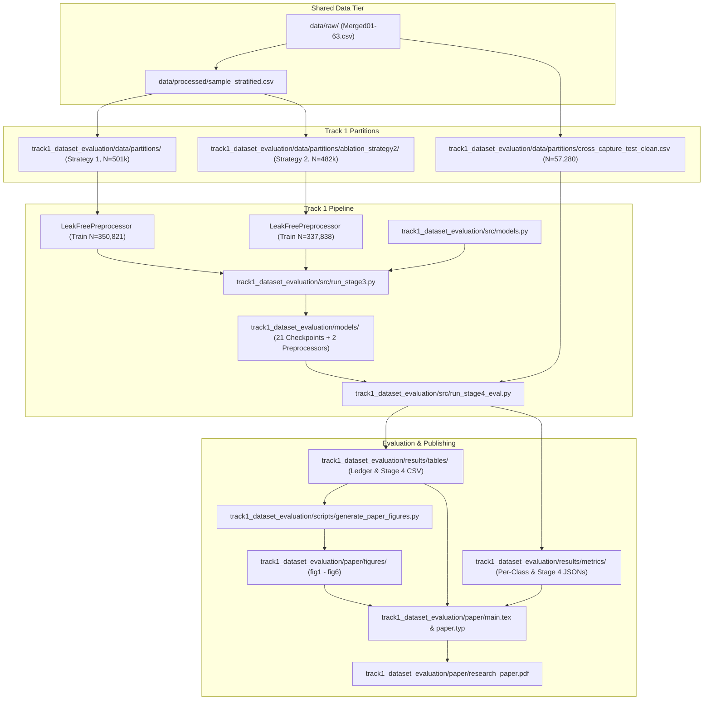

# Repository Architecture & Directory Structure Guide

This document provides a comprehensive structural guide to the CICIoT2023 Intrusion Detection System research repository, organized into **two dedicated research tracks** (`track1_dataset_evaluation/` and `track2_ids_engineering/`). See [`TRACKS_OVERVIEW.md`](TRACKS_OVERVIEW.md) for a concise track-by-track summary.

---

## 1. High-Level Repository Architecture

```text
capstone/
├── .gitignore                             # Comprehensive Git exclusion rules protecting data & models
├── README.md                              # Executive project documentation & pipeline quickstart
├── REPRODUCIBILITY.md                     # Complete end-to-end reproduction playbook
├── PROJECT_STRUCTURE.md                   # (This file) Repository architecture & directory guide
├── TRACKS_OVERVIEW.md                     # High-level two-track categorization map
├── requirements.txt                       # Pinned runtime and experimental dependencies
│
├── track1_dataset_evaluation/             # [TRACK 1] Dataset Integrity Audit, Benchmark & Paper
│   ├── src/                               # Verified Stage 2–8 leak-free pipeline (formerly src_v2/)
│   │   ├── config.py                      # Canonical paths, 39 features, threat tiers, class maps
│   │   ├── data_partitioning.py           # Stage 2 atomic hash-grouped dataset partitioning
│   │   ├── preprocessing.py               # LeakFreePreprocessor (fitted strictly on training splits)
│   │   ├── models.py                      # Model architectures (SGD, RF, LGBM, XGBoost, PyTorch MLP)
│   │   ├── run_stage3.py                  # Stage 3 training orchestrator for all 21 model checkpoints
│   │   ├── run_stage4_eval.py             # Stage 4 read-only dual-test evaluation runner
│   │   ├── ablation_strategy2.py          # Strategy 2 collision-purging partitioning script
│   │   ├── cross_capture.py               # Temporal cross-capture test partition builder
│   │   ├── evaluate.py                    # Multi-metric evaluation and threat-tier metric calculation
│   │   └── verify_partitions.py           # Mathematical verification script proving 0% feature overlap
│   ├── data/partitions/                   # Strategy 1 & Strategy 2 hash-grouped splits + cross-capture tests
│   ├── models/                            # 21 verified Stage 3 checkpoints + 2 preprocessors (gitignored)
│   ├── results/                           # Stage 4 test CSVs, centralized ledger, per-class & stage4 JSONs
│   ├── reports/                           # Master Research Reports (Stages 1–9, audits & blueprints)
│   ├── paper/                             # Academic Manuscript Package (main.tex, paper.typ, figures, PDF)
│   ├── experiments/                       # Raw vs. balanced dataset distribution experiments (exp5, exp7)
│   └── scripts/                           # 300 DPI publication figure generator (generate_paper_figures.py)
│
├── track2_ids_engineering/                # [TRACK 2] Practical IDS Baselines, Optimization & Hierarchy
│   ├── src/                               # Initial 2-class, 8-class, 34-class & feature selection pipeline
│   ├── models/                            # Baseline checkpoints (binary, 8-class, 34-class, top-20) (gitignored)
│   ├── results/                           # Confusion matrices, ROC/PR curves, benchmark & throughput tables
│   ├── experiments/                       # Weight calibration, tuning, pruning & 2-stage cascade ablations
│   ├── scripts/                           # Streamlit SOC console (demo_app.py) & 10G throughput benchmark
│   ├── docs/                              # Engineering insights ledger (INSIGHTS.md) & roadmap (PROGRESS.md)
│   ├── data/                              # Track 2 data docs (hierarchical_ids reads Track 1 Strategy 1 in-memory)
│   └── hierarchical_ids/                  # Implemented & evaluated E1-E4 Cascade vs. Improved Flat IDS study
│
├── data/                                  # [SHARED] Raw captures (data/raw/) & stratified sample (data/processed/)
├── notebooks/                             # Exploratory Jupyter Notebooks (01–09, kept at root)
├── research/                              # [SHARED] 14 peer-reviewed papers, Dataset.pdf & critical survey
├── learning/                              # [SHARED] Educational Module 1 (networking & CICIoT2023)
├── snuc/                                  # Shiv Nadar University Chennai Capstone Deliverables (gitignored)
└── .venv/                                 # Python 3.13 Virtual Environment (gitignored)
```

---

## 2. Directory Purpose & Functional Role Matrix

| Directory | Track / Status | Primary Role & Contents |
|---|:---:|---|
| **`track1_dataset_evaluation/src/`** | Track 1 | Core engine for Stage 2–9 dataset audit & benchmark. Implements leak-free partitioning, strict training-only preprocessing, model training, and read-only test evaluation. |
| **`track1_dataset_evaluation/data/partitions/`** | Track 1 | Strategy 1 primary splits, Strategy 2 collision-purged splits, and clean temporal cross-capture test partitions. |
| **`track1_dataset_evaluation/models/`** | Track 1 | 21 audited Stage 3 checkpoints and 2 serialized preprocessors (`*.joblib`, `*.pt`, gitignored). |
| **`track1_dataset_evaluation/reports/`** | Track 1 | Consolidated repository for all Stage 1–9 research reports, audits, and blueprints. |
| **`track1_dataset_evaluation/results/`** | Track 1 | Per-class JSON metrics, Stage 4 JSONs, centralized experiment ledger, master Stage 4 test CSV, and `exp5`/`exp7` tables. |
| **`track1_dataset_evaluation/paper/`** | Track 1 | Camera-ready academic research paper package containing LaTeX, Typst, BibTeX, publication figures, and compiled PDF (`research_paper.pdf`). |
| **`track2_ids_engineering/src/`** | Track 2 | Baseline 2-class, 8-class, 34-class, and Top-20 feature-selection pipeline code. |
| **`track2_ids_engineering/models/`** | Track 2 | Baseline checkpoints across `binary/`, `category_8class/`, `attack_34class/`, and `reduced_features/` (gitignored). |
| **`track2_ids_engineering/results/`** | Track 2 | Evaluation figures and benchmark/ablation/throughput tables. |
| **`track2_ids_engineering/experiments/`** | Track 2 | Standalone ablations testing class weight calibration, hyperparameter tuning, feature pruning, and 2-stage cascade. |
| **`track2_ids_engineering/scripts/`** | Track 2 | Streamlit SOC dashboard (`demo_app.py`) and CPU throughput benchmarking (`benchmark_throughput.py`). |
| **`track2_ids_engineering/hierarchical_ids/`** | Track 2 | Implemented E1–E4 Hierarchical Cascade vs. Improved Flat 34-class IDS (`docs/COMPARISON_REPORT.md`, CSVs, JSONs, confusion matrices). |
| **`track2_ids_engineering/docs/`** | Track 2 | Engineering ledger (`INSIGHTS.md`) and phased roadmap (`PROGRESS.md`). |
| **`data/`** | Shared | Shared raw CICIoT2023 CSVs (`raw/`) and curated stratified sample (`processed/sample_stratified.csv`, 529k flows). |
| **`research/`** | Shared | Curated academic library containing 14 peer-reviewed research papers and the CICIoT2023 dataset datasheet. |
| **`notebooks/`** | Root | Sequential Jupyter notebooks (`01` to `09`) preserved at root (`09`: hierarchical vs. improved flat evaluation). |
| **`learning/`** | Shared | Educational notebook and learning notes introducing IoT networking and dataset structure. |
| **`snuc/`** | University | Capstone project submission deliverables for Shiv Nadar University Chennai (untouched). |

---

## 3. Track 1 Data Flow Architecture



---

## 4. Git Hygiene & Artifact Management Policy

- **Tracked in Git**: All Python source code (`track1_dataset_evaluation/src/`, `track2_ids_engineering/src/`, `track2_ids_engineering/hierarchical_ids/`, `experiments/`, `scripts/`), research reports (`track1_dataset_evaluation/reports/`), documentation (`TRACKS_OVERVIEW.md`, `PROJECT_STRUCTURE.md`, `README.md`, `track2_ids_engineering/docs/`), research literature (`research/`), academic paper sources (`track1_dataset_evaluation/paper/`), exploratory notebooks (`notebooks/`, `learning/`), partition metadata JSONs, structured summary result tables (`results/tables/*.csv`, `hierarchical_ids/results/*.csv`), and confusion matrices (`hierarchical_ids/results/confusion_matrices/*.npy`).
- **Excluded via `.gitignore`**:
  - Raw and processed datasets (`data/raw/`, `data/processed/`, `track1_dataset_evaluation/data/partitions/*.csv`, `*.csv` except `results/tables/*.csv`).
  - Binary model checkpoints and serialized preprocessors (`track1_dataset_evaluation/models/*`, `track2_ids_engineering/models/*`, `*.joblib`, `*.pt`, `*.pkl`).
  - University capstone submissions (`snuc/`).
  - Python virtual environment (`.venv/`), bytecode caches (`__pycache__/`, `*.pyc`).
