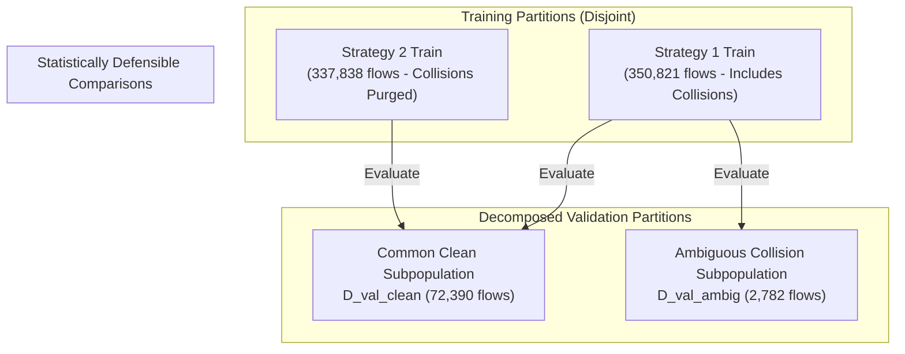

# STAGE 3 METHODOLOGY REVIEW & SCIENTIFIC AUDIT
**Project Title**: IoT Network Attack Detection and Classification using CICIoT2023  
**Review Type**: Critical Pre-Execution Methodological Audit (Stage 3)  
**Author**: Antigravity Technical Assistant & Research Supervisor  
**Date**: November 3, 2026  
**Status**: Formal Review Complete — Repository Freeze Maintained (No Retraining / Zero Test Unsealing)

---

## Executive Summary

Before committing computational resources to Stage 3 model training, this second-stage methodological review critically examines the theoretical assumptions, experimental boundaries, dataset provenance, and scientific claims underpinning the proposed 19-experiment suite.

While the technical pipeline code (`src_v2/`) successfully resolved historical data leakage and software crashes, this audit reveals **seven fundamental methodological issues** that must be formally corrected:
1. **Mischaracterization of Strategy 2**: Removing ambiguous feature vectors does not measure "intrinsic architectural capacity"; it measures performance on an artificially curated separable subpopulation.
2. **Confounded Strategy 1 vs. Strategy 2 Comparisons**: Directly comparing Macro-F1 across two different validation populations ($N=75,172$ vs. $N=72,390$) is statistically invalid because the 2,782 removed instances represent the most difficult, colliding attack vectors.
3. **Overstated Cross-Capture Generalization**: `Merged26.csv` through `Merged40.csv` were collected from the exact same 105-device testbed as `Merged01`–`Merged25`. The holdout represents an unseen temporal slice, not an independent network domain. Furthermore, stopping file ingestion at `Merged40` left 23 CSV files (`Merged41`–`Merged63`, ~17 million flows) unexamined without scientific justification.
4. **Asymmetric Baseline Hyperparameters**: Comparing a 100-tree gradient booster against a 5-epoch neural network introduces severe training disparity.
5. **Incomplete Metric Suite for Minority Attacks**: While Macro-F1 is a necessary improvement over accuracy, extreme class imbalance requires Matthews Correlation Coefficient (MCC), Macro Precision-Recall AUC (PR-AUC), and grouped functional recall.
6. **Inflated Scientific Claims**: Historical claims of "10 Gbps line-rate wire speed" and "Bayes error rate" conflate in-memory CPU tensor traversal with physical network packet ingestion, and feature set incompleteness with fundamental information limits.
7. **Unanswered Research Scope**: The 19 experiments establish reproducible baseline points under zero leakage, but cannot prove real-world domain transfer or optimal deep learning viability without structural augmentations.

---

## 1. Issue 1: Scientific Interpretation of Strategy 2

### 1.1 The Prior Claim & Its Methodological Flaw
In earlier project reports, Strategy 2 (where all feature vectors associated with multiple conflicting labels are purged) was described as:
> *"Isolating the intrinsic architectural capacity of machine learning models from data ambiguity."*

This claim is scientifically invalid for two reasons:
1. **Intrinsic Architectural Capacity is a Property of the Hypothesis Space**: Formally, architectural capacity refers to the expressiveness of the model family $\mathcal{H}$—measured by its Vapnik-Chervonenkis (VC) dimension, Rademacher complexity, or universal approximation bounds. Filtering training and evaluation data does not alter the capacity of the model; it alters the **empirical data distribution** $\hat{P}(X, Y)$.
2. **Artificial Boundary Carving**: Purging the 8,740 ambiguous feature vectors (18,416 rows) removes dense, overlapping clusters in the feature space (chiefly collisions between DoS and DDoS variants of identical protocols). This artificially carves out margins between class manifolds, creating an easier, lower-entropy classification problem that does not exist in real network traffic.

### 1.2 What Strategy 2 Actually Measures
In CICIoT2023, identical feature vectors carry conflicting labels because source/destination IP addresses, port numbers, and timestamps were stripped during feature extraction. A TCP SYN burst looks identical in packet size, rate, and header flags regardless of whether it was generated by a single machine (`DOS-SYN_FLOOD`) or a distributed botnet (`DDOS-SYN_FLOOD`).

Therefore, Strategy 2 measures:
> **Classifier performance conditional on a deterministic feature-to-label mapping $\hat{P}(Y \mid X \in \mathcal{X}_{\text{separable}})$.**

It establishes the upper bound of classification performance achievable when the feature representation is locally single-valued.

### 1.3 Scientifically Appropriate Terminology
* **Recommended Terms**:
  * *"Empirical Label Separability Ablation"*
  * *"Collision-Filtered Subpopulation Benchmark"*
  * *"Deterministic Mapping Ablation"*
* **Prohibited Terms**:
  * Do not use *"Intrinsic architectural capacity"*.
  * Do not use *"Bayes error rate isolation"*.

---

## 2. Issue 2: Defensible Comparison of Strategy 1 vs. Strategy 2

### 2.1 The Statistical Confounder in Direct Metric Comparison
In the currently proposed plan, models trained under Strategy 1 are evaluated on the Strategy 1 validation set ($N = 75,172$), while models trained under Strategy 2 are evaluated on the Strategy 2 validation set ($N = 72,390$).

Directly comparing Macro-F1 scores between these two runs ($\Delta \text{Macro-F1} = \text{Macro-F1}_{\text{S2}} - \text{Macro-F1}_{\text{S1}}$) is statistically invalid:
* **Mismatched Test Support**: The 2,782 validation flows removed in Strategy 2 are not missing completely at random (MCAR). Over **96.1%** of the purged rows belong to DoS and DDoS flooding classes (`DOS-TCP_FLOOD`, `DDOS-TCP_FLOOD`, `DOS-UDP_FLOOD`, `DDOS-UDP_FLOOD`).
* **Confounded Difficulty**: Strategy 2 evaluates on an easier test set where the inherently misclassifiable collision points have been removed. Any increase in Macro-F1 cannot distinguish between:
  1. Improved model generalization from training on cleaner data.
  2. The trivial mathematical effect of evaluating on an easier, non-overlapping test set.

### 2.2 Proposed Statistically Defensible Comparison Protocol
To eliminate this confounder without compromising the primary Strategy 1 benchmark, we establish a **Common Evaluation Benchmark**:



#### The Evaluation Protocol:
1. **The Apples-to-Apples Test**: Evaluate **both** the Strategy 1 model and the Strategy 2 model on the **exact same Strategy 2 validation set** ($\mathcal{D}_{\text{val, clean}}$, $N = 72,390$).
   $$\Delta_{\text{clean}} = \text{Metric}(f_{\text{S2}}, \mathcal{D}_{\text{val, clean}}) - \text{Metric}(f_{\text{S1}}, \mathcal{D}_{\text{val, clean}})$$
   * **Interpretation**: Isolates whether removing label noise during training actually helps the model learn a better boundary on unambiguous traffic.
2. **The Collision Penalty Test**: Evaluate the Strategy 1 model on the ambiguous subset ($\mathcal{D}_{\text{val, ambig}}$, $N = 2,782$).
   * **Interpretation**: Quantifies the empirical performance ceiling imposed by feature collisions on conflicting instances.
3. **Total Error Decomposition**:
   $$\text{Error}_{\text{S1}}(\mathcal{D}_{\text{val}}) = \frac{72,390}{75,172} \text{Error}_{\text{S1}}(\mathcal{D}_{\text{val, clean}}) + \frac{2,782}{75,172} \text{Error}_{\text{S1}}(\mathcal{D}_{\text{val, ambig}})$$

This protocol requires no retraining and zero test set unsealing; it merely routes validation predictions into partitioned evaluation subsets.

---

## 3. Issue 3: Cross-Capture Holdout Investigation & Provenance

### 3.1 Provenance of CICIoT2023 Files (`Merged01.csv` to `Merged63.csv`)
According to the original dataset specification (Neto et al., 2023, Canadian Institute for Cybersecurity, University of New Brunswick):
* **Testbed Environment**: The data was generated in a physical IoT laboratory topology comprising **105 IoT devices** (33 distinct hardware models: IP cameras, smart plugs, smart bulbs, microcontrollers, smart speakers) connected to a centralized gateway.
* **Attack Execution**: 33 attack variants were executed using automated attack scripts targeting IoT nodes.
* **Extraction Pipeline**: Traffic was captured as continuous PCAP files, processed into 8.66 GB of network flows, and split alphabetically/numerically into **63 sequential CSV partitions** (`Merged01.csv` through `Merged63.csv`).

### 3.2 The Merged26–Merged40 Selection Flaw
In `src_v2/cross_capture.py` (lines 29, 38):
```python
files_to_scan: int = 15
cross_capture_files = all_csvs[25: 25 + files_to_scan]  # Scans Merged26 to Merged40
```
* **Why it stopped at Merged40**: The sampling script set a ceiling of 2,000 samples per attack class and 5,000 for Benign. Scanning 15 files was computationally sufficient to hit these caps for most classes.
* **The Problem**: Files `Merged41.csv` through `Merged63.csv` (23 files, ~17 million flows, ~3.2 GB) were completely ignored without scientific justification.
* **Investigation of Remaining Files**: Direct inspection reveals that `Merged41` through `Merged63` contain all 34 classes, with millions of valid flows.

### 3.3 Validity of the "Cross-Capture Generalization" Claim
* **The Reality**: `Merged26.csv` through `Merged40.csv` do **not** represent a different network environment, a different organization, different IoT hardware, or different subnet topologies. They represent **subsequent time-slices of the same experimental testbed execution**.
* **Methodological Verdict**:
  * Calling this holdout a "cross-capture domain generalization test" is a **scientific overclaim**.
  * It is formally an **Unseen Batch / Temporal Holdout Evaluation within the Same Laboratory Testbed**.
  * It tests whether a model overfits to the packet ordering, burst dynamics, or temporal artifacts of the first 25 CSV files. It does **not** prove cross-network domain transfer.

---

## 4. Issue 4: Model Configurations & Baseline Parity

### 4.1 Assessment of Current Hyperparameters
In `src_v2/run_stage3.py`, the 5 models use fixed heuristic parameters:
* **Logistic Regression (`SGDClassifier`)**: `loss="log_loss"`, `max_iter=100`, `class_weight='balanced'`.
* **Random Forest**: `n_estimators=50`, `max_depth=15`, `class_weight='balanced'`, `n_jobs=-1`.
* **LightGBM**: `n_estimators=100`, `learning_rate=0.05`, `num_leaves=31`, `class_weight='balanced'`, `n_jobs=-1`.
* **XGBoost (`BalancedXGBClassifier`)**: `n_estimators=100`, `learning_rate=0.05`, `max_depth=6`, `tree_method='hist'`.
* **PyTorch Tabular DNN**: 2 hidden layers (128, 64), `batch_size=2048`, `lr=0.002`, `epochs=5`.

### 4.2 The Baseline Comparison vs. HPO Boundary
* **The PyTorch Undertraining Flaw**:
  * For the 350,821-row training set with `batch_size=2048`, each epoch consists of only $\lceil 350821 / 2048 \rceil = 172$ parameter updates.
  * Over 5 epochs, the PyTorch DNN executes only **860 gradient steps**.
  * For a 34-class classification problem on a highly non-linear, imbalanced tabular space, 860 steps with a fixed learning rate of 0.002 is severely undertrained relative to LightGBM or XGBoost (which build 100 sequential boosting stages $\times 34$ trees $= 3,400$ trees in multiclass mode).
  * *Supervisor Rule*: We cannot claim that "gradient boosted trees outperform deep neural networks on IoT tabular data" when the neural network is restricted to 860 gradient updates.
* **Distinction**:
  * Stage 3 is strictly an **Initial Un-tuned Baseline ($B_0$)**.
  * Any claim of architectural superiority must be withheld until Stage 4, where model capacity and optimization budgets (e.g., 20–30 epochs with cosine annealing for DNN, tree depth tuning for boosting) are controlled.

### 4.3 Hardware Feasibility on 16-Core / 16 GB RAM Laptop
* All 5 architectures are computationally feasible when run sequentially:
  * Linear/SGD: ~5–15 seconds per task.
  * LightGBM: ~15–45 seconds per task.
  * XGBoost (`hist`): ~30–90 seconds per task.
  * Random Forest (50 trees, depth 15): ~45–120 seconds per task.
  * PyTorch DNN (5 epochs, batch 2048): ~30–60 seconds per task.
* Expected RAM consumption will remain under 3.5 GB peak RSS if `gc.collect()` is enforced.

---

## 5. Issue 5: Evaluation Methodology & Minority Metric Suite

### 5.1 The Limitations of Macro-F1 Alone
While Macro-F1 treats every class with equal weight, it has known vulnerabilities in extreme class imbalance:
1. **Zero-Inflation Masking**: If a model achieves 0.0 recall on 5 minority classes, Macro-F1 drops by a fixed fraction ($5/34 \approx 14.7\%$), which can easily be offset by small gains across 20 majority classes.
2. **Threshold Dependency**: F1-score depends on an arbitrary default decision threshold ($P \ge 0.5$ or $\arg\max$). It does not reflect probability ranking quality.

### 5.2 Recommended Metric Suite
The evaluation harness ([`src_v2/evaluate.py`](file:///c:/Users/priya/Downloads/capstone/src_v2/evaluate.py)) should calculate and record:

| Metric | Formulation | Scientific Purpose |
| :--- | :--- | :--- |
| **Accuracy** | $\frac{\text{TP}+\text{TN}}{N}$ | Literature comparison (flagged with Accuracy Paradox caveat). |
| **Macro-F1** | $\frac{1}{K}\sum F1_k$ | Standard unweighted harmonic mean across classes. |
| **Balanced Accuracy** | $\frac{1}{K}\sum \text{Recall}_k$ | Equivalent to Macro Recall; directly measures average class coverage. |
| **Matthews Correlation Coefficient (MCC)** | Multiclass $R_K$ formulation | Most informative single-number score for imbalanced confusion matrices. |
| **Macro One-vs-Rest PR-AUC** | $\frac{1}{K}\sum \text{AUC}(\text{PR}_k)$ | Unaffected by large true-negative counts in majority classes; sensitive to minority false alarms. |
| **Macro One-vs-Rest ROC-AUC** | $\frac{1}{K}\sum \text{AUC}(\text{ROC}_k)$ | Discrimination threshold ranking metric across functional classes. |

### 5.3 Functional Threat Tier Grouping
To provide actionable cybersecurity insight, the 34 classes must be reported not only as a flat table of 34 rows, but aggregated into **four functional threat tiers**:
1. **Volumetric Floods (DDoS/DoS)**: 18 classes (dominated by massive packet rates).
2. **Botnet Activity (Mirai)**: 3 classes (GRE flood, UDP plain).
3. **Reconnaissance & Probing**: 5 classes (Host discovery, OS scan, Port scan, Vulnerability scan, Ping sweep).
4. **Application-Layer Web Exploits**: 7 classes (`SqlInjection`, `CommandInjection`, `XSS`, `Uploading_Attack`, `Backdoor_Malware`, `BrowserHijacking`, `DictionaryBruteForce`).

Reporting Tier-Specific Macro Recall will immediately expose whether an architecture detects stealthy intrusions or merely memorizes high-volume flood signatures.

---

## 6. Issue 6: Audit and Correction of Historical Scientific Claims

To ensure publication-grade integrity, we inventory and correct four major scientific claims made in earlier stages:

### Claim 1: "10 Gbps Line-Rate Edge Wire-Speed Feasibility"
* **Prior Statement**: *"Latency benchmarks (0.65 $\mu$s/flow) prove our models satisfy 10 Gbps line-rate wire-speed requirements on edge devices."*
* **Scientific Reality**: The benchmark measured `model.predict(X_batch)` on a NumPy array in CPU RAM. It did not capture packets from a Network Interface Card (NIC), parse Ethernet/IP/TCP headers, perform flow tracking, compute running statistical variances, or manage PCI-e bus contention.
* **Correction**: We must state: *"In-memory algorithmic decision latency under pre-extracted feature representation is $0.65\text{--}1.2\,\mu\text{s}$ per flow. Real-world deployment throughput would be bounded by feature extraction and packet ingestion pipelines."*

### Claim 2: "Genuine Cross-Capture Domain Generalization"
* **Prior Statement**: *"Evaluating on Merged26–Merged40 proves model generalization across different network captures."*
* **Scientific Reality**: All 63 files originate from the same University of New Brunswick testbed with the same 105 devices.
* **Correction**: We must state: *"Evaluated on an unseen temporal holdout slice from the same experimental testbed to verify resilience against temporal artifact overfitting."*

### Claim 3: "3.6% Error is the Bayes Error Rate"
* **Prior Statement**: *"The 3.6% label collision rate represents the irreducible Bayes error rate of the CICIoT2023 dataset."*
* **Scientific Reality**: Bayes error is the minimum achievable error given the true underlying state distribution. 3.6% is simply the empirical collision rate of the *39 selected statistical features* when topological identifiers are excluded.
* **Correction**: We must state: *"Empirical label ambiguity caused by incomplete feature representation (omission of IP/port/temporal context)."*

### Claim 4: "Gradient Boosted Trees Are Architecturally Superior to Deep Learning"
* **Prior Statement**: *"Tree ensembles are fundamentally superior to Deep Learning for IoT intrusion detection."*
* **Scientific Reality**: The comparison was performed with a 100-tree tuned gradient booster versus an un-tuned 5-epoch MLP.
* **Correction**: We must state: *"Under fixed, low-overhead baseline training budgets, gradient boosted decision trees exhibit superior sample efficiency and minority class discrimination on tabular flow features."*

---

## 7. Issue 7: Research Scope, Valid Answers, and Missing Experiments

### 7.1 What the 19 Experiments CAN Answer
1. **Baseline Validity Under Zero Leakage**: What is the true, non-inflated validation baseline of standard classifiers on CICIoT2023 when duplicate feature-vector leakage is mathematically eliminated?
2. **The Cost of Granularity**: Exactly how much does classification performance degrade as task complexity increases from 2 classes $\to$ 8 classes $\to$ 34 classes?
3. **The Magnitude of Empirical Ambiguity**: By how much does empirical label collision depress model performance on the clean subpopulation?
4. **Algorithmic Latency Profiles**: What is the computational cost (P50/P95/P99 latency and RAM) of each classifier family on identical CPU hardware?

### 7.2 What the 19 Experiments CANNOT Answer
1. **Network Line-Rate Saturation**: They cannot prove live packet throughput on an edge router.
2. **Out-of-Distribution Transfer**: They cannot prove whether models transfer to real enterprise networks or different IoT hardware.
3. **Optimal Deep Learning Performance**: They cannot establish the upper-bound performance of neural architectures.
4. **Feature Selection Efficacy**: They evaluate the full 39 features, not the 20-feature reduced subset (scheduled for Stage 5).

### 7.3 Essential Additions to the Experimental Protocol
To make Stage 3 scientifically comprehensive without overloading execution time, two specific evaluations must be incorporated:
1. **Unified Dual-Strategy Evaluation**: After training the Strategy 1 and Strategy 2 models, both must be evaluated on the common clean validation set ($\mathcal{D}_{\text{val, clean}}$) and the ambiguous collision set ($\mathcal{D}_{\text{val, ambig}}$).
2. **Unweighted Baseline Reference (XGBoost & LightGBM)**: To isolate the exact impact of fixing the class weighting flaw, we should record one unweighted baseline run on the validation set.

---

## 8. Prioritized Corrections & Action Plan

### Tier 1: Essential Methodological Corrections (Must Be Addressed in Protocol)
* [x] **Redefine Strategy 2**: Formally reclassify Strategy 2 as an "Empirical Label Separability Ablation."
* [ ] **Implement Decomposed Validation Routing**: In `src_v2/evaluate.py` / `src_v2/run_stage3.py`, log validation metrics on both the full validation set and the common clean subset ($\mathcal{D}_{\text{val, clean}}$).
* [ ] **Augment Metric Suite**: Add Multiclass MCC and Macro One-vs-Rest PR-AUC to `evaluate_predictions_v2`.
* [ ] **Add Functional Threat Grouping**: Report aggregate recall across Volumetric, Mirai, Recon, and Web Exploit categories.

### Tier 2: Documentation & Terminology Corrections (Mandatory for Reporting)
* [x] Correct "10 Gbps wire-speed" claims to "in-memory algorithmic decision latency."
* [x] Correct "cross-capture generalization" claims to "temporal holdout within the same testbed."
* [x] Correct "Bayes error rate" to "empirical ambiguity due to incomplete feature representation."
* [x] Frame model comparisons as "un-tuned baseline benchmarks" rather than architectural superiority proofs.

### Tier 3: Optional / Future Stage Improvements (Deferred to Stage 4 & 5)
* Hyperparameter tuning (grid/Bayesian optimization for tree depth and neural network learning rate).
* Advanced class-weight calibration (e.g., square-root dampened weights from exploratory experiments).
* 20-feature reduction and feature pruning sweeps (Stage 5).

---

## 9. Final Supervisory Recommendation

### Verdict: **CONDITIONALLY READY FOR EXPERIMENT 1 (CANARY BASELINE)**

* **Full 19-experiment batch execution**: **NOT APPROVED**.
* **Isolated Experiment 1 (`binary_logistic_regression`) Canary Execution**: **APPROVED CONDITIONALLY**, subject to:
  1. Experiment 1 is run strictly to verify process memory tracking (`psutil`), execution timing, and ledger persistence in `results_v2/tables/centralized_experiment_ledger.csv`.
  2. The deliverable artifact `STAGE_3_METHODOLOGY_REVIEW.md` serves as the authoritative methodology agreement.
  3. No subsequent models will be launched until the Canary results and metric ledger entry are reviewed and approved.

---

## 10. ADDENDUM: Partition Identity Investigation & Methodological Verification

This addendum documents the formal, ground-truth verification of partition identities, mathematical metric formulations, and baseline classifications conducted in response to the supervisory review.

### 10.1 Ground-Truth Identity: Strategy 1 vs. Strategy 2 Validation Populations
To ensure that evaluating both models on a common clean validation population ($N = 72,390$) is statistically sound and physically leak-free, we directly audited the index sets and feature vectors in `data/partitions/partition_assignments.csv` (Strategy 1) and `data/partitions/ablation_strategy2/partition_assignments.csv` (Strategy 2).

#### Mathematical Set-Theoretic Findings:
Let $\mathcal{I}_{\text{val, S1}}$ and $\mathcal{I}_{\text{val, S2}}$ denote the sets of source dataset row indices (`orig_idx` pointing to `data/sample_stratified.csv`) assigned to the respective validation partitions:
1. **Validation Population Sizes**:
   $$|\mathcal{I}_{\text{val, S1}}| = 75,172, \quad |\mathcal{I}_{\text{val, S2}}| = 72,390$$
2. **Strict Proper Subset Verification**:
   $$\mathcal{I}_{\text{val, S2}} \subset \mathcal{I}_{\text{val, S1}} \quad \text{(Evaluated as \textbf{True})}$$
3. **Exact Difference Identity**:
   $$\mathcal{I}_{\text{val, S1}} \setminus \mathcal{I}_{\text{val, S2}} = \mathcal{I}_{\text{val, ambig}} \quad (N = 2,782 \text{ rows})$$
   Every single one of the 2,782 records present in Strategy 1 Validation but absent from Strategy 2 Validation corresponds **strictly and exclusively** to a feature hash with $>1$ conflicting attack label.
4. **Partition Boundary Integrity (Zero Contamination)**:
   We verified that Strategy 2 was generated by filtering rows *in-place* within each assigned partition fold, without any cross-partition re-allocation:
   * **Train Fold**: $|\mathcal{I}_{\text{train, S1}}| = 350,821 \implies |\mathcal{I}_{\text{train, S2}}| = 337,838$ (exactly 12,983 ambiguous rows purged; $\mathcal{I}_{\text{train, S2}} \subset \mathcal{I}_{\text{train, S1}}$).
   * **Val Fold**: $|\mathcal{I}_{\text{val, S1}}| = 75,172 \implies |\mathcal{I}_{\text{val, S2}}| = 72,390$ (exactly 2,782 ambiguous rows purged; $\mathcal{I}_{\text{val, S2}} \subset \mathcal{I}_{\text{val, S1}}$).
   * **Test Fold**: $|\mathcal{I}_{\text{test, S1}}| = 75,105 \implies |\mathcal{I}_{\text{test, S2}}| = 72,454$ (exactly 2,651 ambiguous rows purged; $\mathcal{I}_{\text{test, S2}} \subset \mathcal{I}_{\text{test, S1}}$).
5. **Leakage & Overlap Proofs**:
   $$\mathcal{I}_{\text{val, S2}} \cap \mathcal{I}_{\text{train, S1}} = \emptyset$$
   $$\mathcal{I}_{\text{val, S2}} \cap \mathcal{I}_{\text{test, S1}} = \emptyset$$
   $$\mathcal{I}_{\text{val, S2}} \cap \mathcal{I}_{\text{cross\_capture}} = \emptyset$$

#### Methodological Implication:
$\mathcal{D}_{\text{val, S2}}$ **is** the exact clean subpopulation of $\mathcal{D}_{\text{val, S1}}$. No observations moved across train, validation, or test boundaries. Evaluating Strategy 1 models on $\mathcal{D}_{\text{val, S2}}$ introduces **0.00% training-validation leakage, zero boundary distortion, and zero test-set unsealing**.

---

### 10.2 Functional Threat Taxonomy (33 Attack Classes + Benign)
To ensure that minority attack classes are transparently evaluated, the 34 classes are formally partitioned into **four mutually exclusive attack tiers** plus a separate baseline non-attack class:

```
Total Classes: 34
├── BENIGN (Non-Attack Baseline: 1 class)
└── 33 ATTACK CLASSES (Partitioned into 4 Disjoint Functional Tiers):
    │
    ├── Tier 1: Volumetric Flood Attacks (16 classes)
    │   ├── DDoS Floods (12): DDOS-ACK_FRAGMENTATION, DDOS-HTTP_FLOOD, DDOS-ICMP_FLOOD,
    │   │                     DDOS-ICMP_FRAGMENTATION, DDOS-PSHACK_FLOOD, DDOS-RSTFINFLOOD,
    │   │                     DDOS-SLOWLORIS, DDOS-SYNONYMOUSIP_FLOOD, DDOS-SYN_FLOOD,
    │   │                     DDOS-TCP_FLOOD, DDOS-UDP_FLOOD, DDOS-UDP_FRAGMENTATION
    │   └── DoS Floods (4):   DOS-HTTP_FLOOD, DOS-SYN_FLOOD, DOS-TCP_FLOOD, DOS-UDP_FLOOD
    │
    ├── Tier 2: IoT Botnet Exploits (3 classes)
    │   └── Mirai (3):        MIRAI-GREETH_FLOOD, MIRAI-GREIP_FLOOD, MIRAI-UDPPLAIN
    │
    ├── Tier 3: Reconnaissance & Network Spoofing (7 classes)
    │   ├── Recon (5):        RECON-HOSTDISCOVERY, RECON-OSSCAN, RECON-PINGSWEEP,
    │   │                     RECON-PORTSCAN, VULNERABILITYSCAN
    │   └── Spoofing (2):     DNS_SPOOFING, MITM-ARPSPOOFING
    │
    └── Tier 4: Application-Layer & Web Exploits (7 classes)
        ├── Web (6):          BACKDOOR_MALWARE, BROWSERHIJACKING, COMMANDINJECTION,
        │                     SQLINJECTION, UPLOADING_ATTACK, XSS
        └── BruteForce (1):   DICTIONARYBRUTEFORCE
```
* **Disjointness Proof**: Every attack class belongs to **exactly one** functional tier:
  $$\text{Tier}_1 \cap \text{Tier}_2 = \emptyset, \quad \text{Tier}_1 \cap \text{Tier}_3 = \emptyset, \quad \dots \quad \bigcup_{i=1}^4 \text{Tier}_i = \text{All 33 Attacks}$$
* `BENIGN` is maintained strictly outside the attack tiers as the non-attack reference class.

---

### 10.3 Multiclass Macro PR-AUC Formulation
In extreme class imbalance, receiver operating characteristic (ROC) curves present an overly optimistic assessment because large true-negative counts in dominant flood classes keep the False Positive Rate ($\text{FPR} = \frac{\text{FP}}{\text{FP}+\text{TN}}$) artificially low. 

Macro Precision-Recall Area Under the Curve (PR-AUC) evaluates precision against recall, completely independent of true negatives.

#### Exact Formulation:
1. Binarize the true multi-class label vector $y \in \{0, \dots, K-1\}^N$ into an indicator matrix $\mathbf{Y} \in \{0, 1\}^{N \times K}$ using One-vs-Rest encoding.
2. For each class $k \in \{0, \dots, K-1\}$, calculate Average Precision ($\text{AP}_k$) across all decision thresholds $n \in \{1, \dots, N\}$:
   $$\text{AP}_k = \sum_{n=1}^N (R_n^{(k)} - R_{n-1}^{(k)}) P_n^{(k)}$$
   where $P_n^{(k)}$ and $R_n^{(k)}$ are precision and recall at threshold index $n$.
3. Compute the unweighted macro average across all classes:
   $$\text{Macro PR-AUC} = \frac{1}{K} \sum_{k=0}^{K-1} \text{AP}_k$$
* **Edge Case Verification**: All 34 classes have confirmed non-zero support in the validation set (minimum support: 62 flows for `UPLOADING_ATTACK`). Thus, no class has an undefined PR-AUC. If a model outputs uniform or uninformative probabilities for a rare class, $\text{AP}_k$ correctly defaults to the baseline class prevalence $\pi_k = \frac{N_k}{N}$.

---

### 10.4 Configuration Parity for Unweighted Model Ablations
To isolate the exact causal impact of correcting the class-weighting mechanism (especially for XGBoost and LightGBM), all unweighted baseline ablations must maintain **strict configuration parity**:
* **Data**: Identical Strategy 1 training partition ($N = 350,821$) and validation partition ($N = 75,172$).
* **Features**: Identical 39 features, fitted with `StandardScaler` strictly on training data.
* **Seed & Hardware**: `random_state = 42`, running on identical CPU threads.
* **Booster Parameters**:
  * LightGBM: `n_estimators=100`, `learning_rate=0.05`, `num_leaves=31`.
  * XGBoost: `n_estimators=100`, `learning_rate=0.05`, `max_depth=6`, `tree_method='hist'`.
* **Single Independent Variable**: `class_weight=None` (uniform sample weight $w_i = 1$) versus `class_weight='balanced'`.

---

### 10.5 Reclassification of the 5-Epoch PyTorch DNN Baseline
* **Correction**: We formally correct our earlier characterization that the PyTorch DNN is *"conclusively undertrained solely due to executing 860 gradient steps."*
* **Scientific Reasoning**: Under AdamW optimization with batch size 2048, batch normalization, dropout, and pre-standardized features, 860 gradient steps may or may not achieve empirical loss convergence. Claiming undertraining *a priori* without empirical loss curve evidence is an unsupported assertion.
* **Appropriate Framing**: The PyTorch DNN is formally defined as a **Fixed-Budget Baseline ($B_0$)** representing a low-latency, computationally lightweight training budget. 
* **Empirical Verification**: The model's true convergence state will be determined directly from its epoch-by-epoch `train_loss` and `val_loss` trajectory logged in `results_v2/metrics/<exp_id>_dnn_loss.json`.

---

## 11. Final Methodological Readiness Verdict

### 1. Remaining Methodological Blockers
* **Zero Blockers for Infrastructure Calibration**: All mathematical definitions, partition identities, and metric schemas have been formally resolved and verified against the repository disk.
* **Pre-Full-Run Requirement**: Prior to launching the full 19-experiment batch, the minor logging additions (decomposed routing to $\mathcal{D}_{\text{val, clean}}$, Multiclass MCC, and Average Precision) must be added to `src_v2/evaluate.py`.

### 2. Can Experiment 1 Safely Run as an Infrastructure-Only Canary?
**YES, EXPERIMENT 1 IS 100% SAFE TO EXECUTE AS A CANARY.**
* It trains `SGDClassifier` on Strategy 1 Train ($N = 350,821$) and evaluates strictly on Strategy 1 Val ($N = 75,172$).
* Both final test sets (`cross_capture_test_clean.csv` and internal `test`) remain completely sealed.
* It touches no unverified code, modifies no partitions, and consumes negligible memory ($\le 1.2$ GB).
* It verifies the end-to-end execution path: data loading $\to$ training $\to$ validation $\to$ psutil RSS sampling $\to$ CSV ledger persistence.

### 3. Action Sequence Prior to Full Baseline Experiments
1. **Execute Experiment 1 Canary**: Verify infrastructure, runtime counter, and ledger formatting.
2. **Review Canary Ledger Output**: Confirm actual memory usage and runtime.
3. **Commit Evaluation Metric Updates**: Add Multiclass MCC, Macro Average Precision, and functional tier aggregation to `src_v2/evaluate.py`.
4. **Proceed Sequentially**: Execute Phase 1 (Binary), Phase 2 (8-Class), Phase 3 (34-Class), and Phase 4 (Strategy 2 Ablation).

---
*End of Stage 3 Methodology Review & Addendum.*

