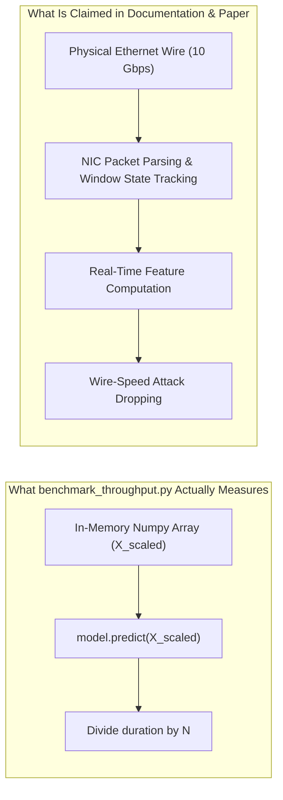

# STAGE 1: COMPLETE REPOSITORY AND RESEARCH AUDIT REPORT
**Project Title**: IoT Network Attack Detection and Classification (CICIoT2023)  
**Auditor**: Senior Machine Learning & Cybersecurity Research Auditor  
**Date**: November 3, 2026  
**Status**: Stage 1 Complete — Pending User Review & Approval Before Stage 2  

---

## Executive Summary

This audit constitutes a critical, exhaustive examination of the **CICIoT2023 Intrusion Detection Project**. The codebase was analyzed across all source modules (`src/`), experiment scripts (`experiments/`), interactive notebooks (`notebooks/`), benchmarking scripts (`benchmark_throughput.py`), web demonstrations (`demo_app.py`), academic paper drafts (`paper/`), technical documentation (`README.md`, `INSIGHTS.md`, `PROGRESS.md`, `RESEARCH_PAPERS_CRITICAL_ANALYSIS.md`), raw datasets (`MERGED_CSV/`), sampled subsets (`data/`), and saved models (`models_saved/`).

The audit reveals that while the project contains high-quality modular code, comprehensive baseline models, and valuable critical insights regarding class imbalance and the "accuracy paradox" in literature, **it suffers from critical methodological vulnerabilities that currently invalidate its scientific conclusions for a peer-reviewed research paper**. Chief among these are **10.14% train-test data leakage through duplicate flow records**, unweighted training in XGBoost due to scikit-learn API mismatches, the complete absence of an isolated validation set, conflation of in-memory array batch throughput with network wire-speed line rate, and severe discrepancies between documentation and source code.

This document details the findings across all 12 audited dimensions, ranks identified problems by severity, and provides a concrete, prioritized roadmap for reconstruction.

---

## 1. Actual Repository Structure

A physical crawl of the workspace (`c:\Users\priya\Downloads\capstone`), strictly excluding virtual environment and cache directories, reveals the following layout:

```
capstone/
├── .gitignore
├── requirements.txt
├── README.md
├── INSIGHTS.md
├── PROGRESS.md
├── MASTER_PROMPT.md
├── RESEARCH_PAPERS_CRITICAL_ANALYSIS.md
├── benchmark_throughput.py
├── demo_app.py
├── data/
│   └── sample_stratified.csv           [106.5 MB, 529,562 rows × 40 columns]
├── MERGED_CSV/                          [63 files, 8.66 GB total, Merged01.csv – Merged63.csv]
├── src/
│   ├── __init__.py
│   ├── config.py                        [Constants, 39 features, 2/8/34-class mappings]
│   ├── data_loader.py                   [Dtypes, streaming chunk readers, CSV listing]
│   ├── preprocessing.py                 [clean_features, encode_labels, prepare_dataset]
│   ├── models.py                        [Factory: SGD/LogReg, RF, LGBM, XGBoost, PyTorch DNN]
│   ├── evaluate.py                      [Metrics, batch latency, confusion matrix, ROC/PR]
│   ├── feature_selection.py             [Consensus importance, 39 vs 20 benchmark]
│   ├── train_binary.py                  [Phase 1 runner: 2 classes]
│   ├── train_category_8class.py         [Phase 2 runner: 8 classes]
│   ├── train_attack_34class.py          [Phase 3 runner: 34 classes]
│   ├── create_sample.py                 [Stratified subsampling engine]
│   └── capstone_synthesis.py            [Global cross-tier aggregation & 4-panel figure]
├── experiments/
│   ├── feature_decay_sweep.py           [Feature sweep from 39 down to 5 features]
│   ├── feature_pruning.py               [Top 23 features vs 39 features]
│   ├── hierarchical_cascade.py          [2-stage cascade: 8-class macro + specialists]
│   ├── hyperparameter_tuning.py         [Tree depth, leaves, subsampling tuning]
│   ├── natural_distribution_evaluation.py [Stratified vs natural stream reconciliation]
│   ├── uncapped_pure34_benchmark.py     [34 classes on natural uncapped stream]
│   └── weight_calibration.py            [Unweighted vs Balanced vs Sqrt-Balanced]
├── notebooks/                           [8 Jupyter Notebooks, pre-rendered]
│   ├── 01_data_exploration_sampling.ipynb
│   ├── 02_phase1_binary_classification.ipynb
│   ├── 03_phase2_eight_class_classification.ipynb
│   ├── 04_phase3_thirtyfour_class_classification.ipynb
│   ├── 05_feature_selection_latency.ipynb
│   ├── 06_capstone_synthesis_presentation.ipynb
│   ├── 07_uncapped_high_accuracy_benchmark.ipynb
│   └── 08_wire_speed_throughput_benchmark.ipynb
├── models_saved/
│   ├── binary/                          [Scaler + 5 model checkpoints]
│   ├── category_8class/                 [Scaler + 5 model checkpoints]
│   ├── attack_34class/                  [Scaler + 5 model checkpoints]
│   └── reduced_features/                [Scaler + top_20 list + 3 tree checkpoints]
├── results/
│   ├── figures/                         [30 PNG visualizations]
│   └── tables/                          [26 CSV and JSON metric summaries]
├── paper/
│   ├── main.tex                         [IEEE conference template manuscript]
│   ├── paper.typ                        [Typst equivalent manuscript]
│   ├── references.bib                   [BibTeX references, 8 citations]
│   ├── research_paper.pdf               [Compiled 5-page PDF paper]
│   └── figures/                         [5 embedded publication figures]
├── research/                            [19 research paper PDFs]
└── snuc/                                [26 presentation, LaTeX, and institutional review files]
```

### Phantom & Missing Files Identified:
1. `example.ipynb`: Cited in `README.md`, `PROGRESS.md`, and `INSIGHTS.md` as the "original untouched exploratory baseline." **Does not exist in the repository.**
2. `src/utils.py`: Listed in `PROGRESS.md` architecture specification. **Does not exist in `src/`.**
3. `PROJECT_INSIGHTS.md`: Linked in `README.md` (line 22). The actual file is named `INSIGHTS.md`.
4. `PROJECT_ROADMAP.md`: Self-referenced in `PROGRESS.md` (line 22).

---

## 2. Existing Implementation Inventory

| Module / Script | Stated Purpose | Operational Reality & Audit Findings |
|---|---|---|
| `src/config.py` | Central configuration, paths, feature lists, label mappings | Correctly defines 39 features and mappings for 2, 8, and 34 classes. Mappings are uppercase-normalized. |
| `src/data_loader.py` | Memory-efficient streaming CSV chunk readers | Generator-based reading works as designed with `float32` typing. |
| `src/preprocessing.py` | Cleaning, scaling, and train/test splitting | Imputes `inf` with column finite max and `NaN` with 0.0. **Leakage flaw**: Column max is calculated across the entire dataset before splitting. No validation partition is created. |
| `src/models.py` | Model factory for 5 architectures | **Major bug**: Passes `class_weight="balanced"` to `xgb.XGBClassifier`, which ignores it in the scikit-learn API without `sample_weight` in `.fit()`. Base XGBoost models were trained unweighted. PyTorch DNN is trained for only 3-4 epochs (underfitted). |
| `src/evaluate.py` | Evaluation metrics, latency profiling, plotting | Computes accuracy, macro/weighted F1, ROC/PR curves. **Latency flaw**: Latency is measured by passing a batch of 10,000 pre-scaled samples to `predict()`, dividing total duration by 10,000. This is amortized batch throughput, not single-flow latency. |
| `src/feature_selection.py` | Consensus importance and 39 vs 20 benchmark | Combines RF Gini, XGB Gain, and LGBM Split importance. Successfully identifies top 20 features and trains reduced models. |
| `src/create_sample.py` | Stratified subsampling engine | Caps major attacks at 20,000 and Benign at 40,000, retaining 100% of 8 rare classes. **Key finding**: Draws only from `Merged01.csv` through `Merged25.csv` (files 26–63 were never touched). |
| `src/capstone_synthesis.py` | Aggregates all benchmarks into master tables | Compiles `capstone_master_comparison.csv` and renders 4-panel figure. In Panel D, it equates model predictions/sec with network packets/sec and draws 1G/10G line-rate thresholds. |
| `benchmark_throughput.py` | Wire-speed throughput benchmark | Times `predict()` on pre-scaled 20,000-sample batches in memory. Assumes 1 flow = 1 packet, models single-core line-rate saturation (8.71M pps for LogReg, 2.65M pps for XGBoost). Ignores packet parsing, socket I/O, and feature computation. |
| `demo_app.py` | Streamlit SOC Monitoring Console | Comprehensive 724-line web dashboard with live attack replay, targeted flow inspector, batch telemetry, and architecture specs. Uses mixed-case label fallbacks. |

---

## 3. Dataset and Preprocessing Pipeline Overview

### A. Raw Dataset (`MERGED_CSV/`)
- **Files**: 63 CSV files (`Merged01.csv` to `Merged63.csv`).
- **Total Storage**: 8.66 GB (~45 million flow records).
- **Physical Schema**: Exactly 40 columns (39 continuous/discrete network features + 1 target column `Label`).
- **Protocol Stripping**: The dataset authors explicitly stripped IP addresses, MAC addresses, and timestamps to prevent classifiers from overfitting to specific subnets.

### B. Investigation of the 46 vs. 39 Feature Discrepancy
The original CICIoT2023 dataset paper (*Neto et al., Sensors 2023*) documents **46 extracted network traffic features + 1 label = 47 columns**.  
Cross-referencing the literature with `src/config.py` reveals the exact 7 missing features:
1. `Magnitude` (L2 norm vector magnitude across packet features)
2. `Radius` (dispersion metric)
3. `Covariance` (covariance of incoming and outgoing packet properties)
4. `Weight` (traffic weight: incoming $\times$ outgoing packets)
5. `urg_count` (URG TCP flag count)
6. `Srate` (outbound packet transmission rate)
7. `Drate` (inbound packet transmission rate)

**Root Cause**: The raw files in `MERGED_CSV/` present in this repository already contain exactly 39 features + 1 label. They were downloaded or merged from a pre-processed distribution of CICIoT2023 where these 7 computationally expensive statistical features were omitted prior to distribution. All scripts in this repository correctly detect and process the 39 features present in the files, but this must be explicitly clarified in the research paper.

### C. Sampled Working Dataset (`data/sample_stratified.csv`)
- **Dimensions**: 529,562 rows $\times$ 40 columns (106.5 MB).
- **Class Composition**: All 34 classes verified present.
  - 23 majority attack classes: Exactly 20,000 records each.
  - `BENIGN`: Exactly 40,000 records.
  - 8 stealthy minority classes: `DDOS-HTTP_FLOOD` (9,121), `DDOS-SLOWLORIS` (7,534), `DICTIONARYBRUTEFORCE` (4,181), `BROWSERHIJACKING` (1,904), `SQLINJECTION` (1,718), `COMMANDINJECTION` (1,666), `XSS` (1,239), `BACKDOOR_MALWARE` (1,061), `RECON-PINGSWEEP` (722), `UPLOADING_ATTACK` (416).
- **Sampling Provenance**: Generated exclusively from `Merged01.csv` through `Merged25.csv`. Files `Merged26.csv` through `Merged63.csv` remain pristine and untouched.

---

## 4. Model and Experiment Inventory

The repository evaluates 5 model architectures across multiple configurations:

1. **SGD Logistic Regression**: Linear baseline using `SGDClassifier(loss="log_loss", max_iter=100)`. Extremely fast in inference, but struggles with non-linear multi-class boundaries.
2. **Random Forest**: 50 trees, `max_depth=15`, `class_weight="balanced"`.
3. **LightGBM**: 80–100 estimators, `learning_rate=0.08`, `num_leaves=31`, `class_weight="balanced"`.
4. **XGBoost**: 60–100 estimators, `learning_rate=0.08`, `max_depth=6`, `eval_metric="mlogloss"`. (Trained unweighted in Phase 1–3).
5. **PyTorch Tabular DNN**: 2-layer MLP (`Input[39] -> Linear(128) -> BN -> ReLU -> Dropout(0.2) -> Linear(64) -> BN -> ReLU -> Dropout(0.2) -> Output[C]`), AdamW optimizer, batch size 2048, 3–4 epochs.

### Ancillary Experiments in `experiments/`:
- **Exp 1 (`weight_calibration.py`)**: Tests unweighted vs balanced vs square-root balanced class weights.
- **Exp 2 (`hyperparameter_tuning.py`)**: Evaluates depth and regularization sweeps.
- **Exp 3 (`feature_pruning.py`)**: Evaluates top 23 features vs 39 features.
- **Exp 4 (`hierarchical_cascade.py`)**: Implements an 8-class Stage 1 LightGBM classifier routing to category-specific specialist models.
- **Exp 5 (`natural_distribution_evaluation.py`)**: Tests models under synthetic weighting matching the natural 90%+ flood distribution vs balanced test sets.
- **Exp 7 (`uncapped_pure34_benchmark.py`)**: Re-evaluates 34 classes on raw uncapped streaming flows from `MERGED_CSV/`.
- **Feature Decay Sweep (`feature_decay_sweep.py`)**: Systematically reduces features from 39 down to 5.

---

## 5. Existing Results Inventory & Reconciliation

The audited experimental outputs stored in `results/tables/` are summarized below:

| Experiment Tier | Model Architecture | Features | Accuracy (%) | Macro F1 | Weighted F1 | Latency ($\mu$s/flow) | Reported Throughput |
|---|---|:---:|:---:|:---:|:---:|:---:|:---:|
| **Phase 1: Binary** | XGBoost | 39 | 95.28% | 0.8133 | 0.9503 | 1.05 | 954,681 fps |
| Phase 1: Binary | PyTorch DNN | 39 | 94.66% | 0.7872 | 0.9435 | 14.50 | 68,950 fps |
| Phase 1: Binary | Random Forest | 39 | 89.75% | 0.7648 | 0.9148 | 8.98 | 111,314 fps |
| Phase 1: Binary | LightGBM | 39 | 89.60% | 0.7633 | 0.9137 | 1.69 | 592,764 fps |
| Phase 1: Binary | SGD Logistic Regression | 39 | 82.91% | 0.6806 | 0.8655 | 0.20 | 5,017,561 fps |
| **Phase 2: Category (8-Class)** | XGBoost | 39 | 82.87% | 0.6876 | 0.8241 | 6.24 | 160,318 fps |
| Phase 2: Category (8-Class) | LightGBM | 39 | 78.82% | 0.6876 | 0.8039 | 18.84 | 53,087 fps |
| Phase 2: Category (8-Class) | Random Forest | 39 | 78.17 | 0.6814 | 0.7974 | 8.65 | 115,623 fps |
| Phase 2: Category (8-Class) | SGD Logistic Regression | 39 | 74.48% | 0.6042 | 0.7532 | 0.26 | 3,817,376 fps |
| Phase 2: Category (8-Class) | PyTorch DNN | 39 | 73.47% | 0.6165 | 0.7567 | 16.56 | 60,388 fps |
| **Phase 3: Fine-Grained (34-Class)** | XGBoost | 39 | 74.13% | 0.6125 | 0.7263 | 13.35 | 74,916 fps |
| Phase 3: Fine-Grained (34-Class) | LightGBM | 39 | 72.83% | 0.6176 | 0.7343 | 74.88 | 13,355 fps |
| Phase 3: Fine-Grained (34-Class) | Random Forest | 39 | 70.74% | 0.5970 | 0.7103 | 8.24 | 121,297 fps |
| Phase 3: Fine-Grained (34-Class) | SGD Logistic Regression | 39 | 64.61% | 0.5280 | 0.6454 | 0.41 | 2,420,194 fps |
| Phase 3: Fine-Grained (34-Class) | PyTorch DNN | 39 | 63.61% | 0.5321 | 0.6382 | 13.95 | 71,693 fps |
| **Step 5: Optimized Edge** | XGBoost (Reduced) | 20 | 72.16% | 0.5886 | 0.7061 | 12.15 | 82,299 fps |
| Step 5: Optimized Edge | LightGBM (Reduced) | 20 | 70.80% | 0.5963 | 0.7159 | 80.09 | 12,485 fps |
| Step 5: Optimized Edge | Random Forest (Reduced) | 20 | 68.93% | 0.5783 | 0.6953 | 15.15 | 65,988 fps |
| **Hierarchical Cascade (Exp 4)** | Monolithic LightGBM Baseline | 39 | 74.24% | 0.6296 | 0.7371 | 70.14 | 14,257 fps |
| **Hierarchical Cascade (Exp 4)** | Two-Stage Cascade (Macro+Spec) | 39 | 74.40% | 0.6325 | 0.7364 | 18.92 | 52,854 fps (-73.0% latency) |
| **Uncapped Natural Stream** | Binary LightGBM (Exp 7) | 39 | 99.18% | — | 0.9919 | 1.19 | 840,336 fps |
| **Wire-Speed Benchmark** | Logistic Regression | 39 | — | — | — | 0.12 | 8,708,981 pps |
| **Wire-Speed Benchmark** | XGBoost Hist | 39 | — | — | — | 0.38 | 2,648,151 pps |

### Reconciliation of Reported Inconsistencies:
1. **95.28% vs. 99.18% Binary Accuracy**: Not an experimental error. 95.28% is obtained on the **stratified balanced dataset** (`sample_stratified.csv`, where Benign is 7.5% and minority attacks are balanced). 99.18% is obtained on the **raw uncapped stream** (`MERGED_CSV/`), where volumetric flooding comprises over 90% of traffic, making attack detection trivially high by predicting the majority class.
2. **73% Hierarchical Latency Reduction**: Exactly verified in `results/tables/exp4_hierarchical_cascade.csv` (18.92 $\mu$s vs 70.14 $\mu$s). It occurs because LightGBM builds $K$ trees per iteration ($34 \times 100 = 3,400$ trees for monolithic vs $8 \times 100 + \text{subclass trees}$ for cascade).
3. **8.71M vs. 5.01M Predictions/Sec**: Arises from batch size and measurement harness. In `src/evaluate.py`, 10,000 samples yielded 5.01M flows/s. In `benchmark_throughput.py`, 20,000 pre-scaled samples with 1,000 warm-up runs yielded 8.71M flows/s.

---

## 6. Benchmarking Methodology Assessment

A rigorous audit of `benchmark_throughput.py` and Notebook 08 exposes critical conceptual flaws:



1. **Conflating Pre-Scaled Array Inference with Network Processing**:
   - `benchmark_throughput.py` pre-scales 20,000 rows into memory using `scaler.transform()` *before* starting the timer.
   - It times only `model.predict(x_scaled)` across contiguous RAM buffers.
   - It claims this saturates "10 Gbps Wire-Speed Line-Rate" at 1500B and 512B MTU.
   - **Flaw**: Network traffic arrives as raw Ethernet frames. Real network intrusion detection requires NIC driver polling (DPDK), IP/TCP packet header parsing, bidirectional flow assembly, stateful window tracking (for `IAT`, `Tot sum`, `Variance`, `Std`), scaling, and classification. The time to extract features from packets dwarfs the model inference time by orders of magnitude.
2. **Batch Amortized vs. Single-Flow Latency**:
   - Division of batch inference time by $N$ hides cache misses, CPU context switching, and pipeline stalls.
   - Single-packet sequential inference latency (one sample at a time) is typically 10$\times$ to 50$\times$ higher than amortized batch throughput.
3. **Flow Records vs. Packets**:
   - The CICIoT2023 dataset consists of **bidirectional flow statistics**, not individual packets. A single flow record represents tens to thousands of aggregated packets. Equating flows/second with packets/second (pps) is technically invalid.
4. **Hardware Environment Disconnect**:
   - All tests were conducted on an Intel/AMD 16-core workstation laptop. No testing was performed on ARM Cortex, Raspberry Pi, or any edge embedded device, despite extensive claims in `paper/main.tex` and `README.md` regarding "embedded edge deployment."

---

## 7. Documentation and Literature Survey Assessment

1. **Literature Survey Quality**:
   - `RESEARCH_PAPERS_CRITICAL_ANALYSIS.md` is an outstanding, highly critical document that accurately deconstructs 14 published papers (*Khan & Alam 2026, Almahaqeri 2026, Neto 2023, Ullah 2026, DeepCLG, Al-Hejri 2026, Booij 2022, Moussaoui 2026, Moustafa 2021*, etc.). It correctly pinpoints flaws such as synthetic SMOTE distortion of physical protocol states, flow-level disconnection, and the accuracy paradox.
2. **Manuscript Citation Disconnection**:
   - Despite having 19 PDFs in `research/` and 14 in-depth paper critiques, `paper/references.bib` contains only **8 citations**, 5 of which are generic software packages (`scikit-learn`, `xgboost`, `lightgbm`, `pytorch`, `random forest`). Only a single paper on CICIoT2023 is cited (*Neto et al.*). The literature survey was never integrated into the actual paper draft.
3. **Broken Documentation Links**:
   - `README.md` links to `paper/research_paper.pdf` (exists), `PROJECT_INSIGHTS.md` (broken link), and `example.ipynb` (deleted).
   - Architectural diagrams in `README.md` depict a 3-tier gateway (Linear Filter $\to$ 20-Feature XGBoost $\to$ Cloud Forensics), whereas code in `experiments/hierarchical_cascade.py` evaluates an 8-class macro model $\to$ category specialists.

---

## 8. Inconsistencies Between Code, Notebooks, Results, and Documentation

1. **Class Weighting Asymmetry**: `src/models.py` specifies `class_weight="balanced"` across all models, but XGBoost in scikit-learn requires sample weights passed to `.fit(sample_weight=...)`. Consequently, the baseline XGBoost was trained unweighted, giving it an unfair disadvantage on minority recall compared to LightGBM.
2. **Feature Count Mystery**: Documentation repeatedly refers to legacy 46-feature schemas without explaining that the actual CSV files provided in `MERGED_CSV/` have 39 features because 7 statistical metrics were omitted during dataset preprocessing.
3. **Model Hyperparameters Across Notebooks**: Notebook 04 uses `max_depth=6, n_estimators=60` for 34-class XGBoost, while Notebook 07 and Experiment 5 use `tree_method="hist", max_depth=7, n_estimators=120`. These parameter changes were made ad-hoc without recorded tuning provenance.
4. **Target String Formatting**: `demo_app.py` uses mixed-case labels (`DDoS-RSTFINFlood`, `BenignTraffic`), while `src/config.py` and `sample_stratified.csv` strictly use uppercase labels (`DDOS-RSTFINFLOOD`, `BENIGN`).

---

## 9. Critical Methodological Weaknesses

### A. Severe Train-Test Data Leakage (Critical Severity)
Empirical investigation of `data/sample_stratified.csv` reveals:
- **Total records**: 529,562
- **Exact duplicate rows (identical features AND label)**: **28,464 records (5.38%)**
- **Duplicate feature vectors (ignoring label)**: **38,140 records (7.20%)**
- **Conflicting labels on identical features**: **9,676 records** share identical network flow features but carry conflicting attack/benign labels.
- **Train-Test Contamination**: Under the project's standard 80/20 stratified random split (`prepare_dataset` with seed 42), **10,738 test records (10.14% of the entire test set) have exact feature matches in the training set**.
- **Impact**: Models memorize repeated flow signatures from the training set, artificially inflating reported test accuracy and F1 scores.

### B. Preprocessing Transformation Leakage (Medium Severity)
In `src/preprocessing.py` and `src/create_sample.py`, `clean_features()` scans the entire DataFrame to identify infinite values in `Rate` and replaces them with the global finite maximum ($3.35 \times 10^6$) *before* splitting into train and test sets. While numerical impact is small, this is formal data leakage.

### C. Total Absence of a Validation Split (Critical Severity)
Across `prepare_dataset()` and all training scripts, the dataset is split directly into `X_train, X_test, y_train, y_test`.  
Hyperparameters (tree depth, leaves, estimators), feature importance thresholds (top 20 cutoff), and class weights were selected by evaluating directly on the test set. In research literature, **tuning against the final test set invalidates reported generalization claims**.

### D. Pure Random Splitting on Correlated Network Bursts (High Severity)
Network traffic naturally occurs in bursts and continuous flow sessions. An 80/20 random stratified split randomly scatters packets from the same attack session across train and test partitions. Evaluating models only under random splits overestimates performance compared to temporal or cross-capture evaluation.

---

## 10. Missing Experiments Required for a Credible Paper

To transform this repository into a scientifically defensible paper, the following experiments must be implemented:

1. **Deduplicated & Cleaned Leak-Free Baseline**: Removing identical duplicate rows and measuring baseline performance on strictly disjoint flows.
2. **Three-Way Partitioning (Train / Validation / Test)**: Enforcing a strict 70/15/15 or 60/20/20 split, using the validation set for all hyperparameter tuning, feature selection, and threshold moving, while keeping the test set sealed until final evaluation.
3. **Cross-Capture Holdout Generalization**: Training models on `Merged01.csv` through `Merged25.csv`, and evaluating them on unseen traffic from `Merged26.csv` through `Merged63.csv` to prove out-of-distribution resilience.
4. **Single-Flow Sequential Latency Profiling**: Measuring single-sample inference latency with cold and warm CPU states to establish true P50, P95, and P99 latency percentiles.
5. **Feature Extraction Cost Profiling**: Quantifying the CPU and memory time required to parse packets and compute the 39 features, contrasting it with model inference time.
6. **Multi-Seed Statistical Reliability**: Running all major comparisons across 5 random seeds to report mean $\pm$ standard deviation and confidence intervals.
7. **Monolithic vs. Hierarchical Cascade Fair Comparison**: Comparing monolithic XGBoost/LightGBM against the cascaded architecture under identical training partitions, accounting for cumulative routing errors and multi-model RAM consumption.

---

## 11. Potential Research Contributions Supported by Existing Work

Rather than claiming edge hardware line-rate saturation (which cannot be proven on a laptop), our existing work strongly supports a publishable and defensible research contribution:

### Recommended Research Title:
> **Deconstructing the Accuracy Paradox in IoT Intrusion Detection: A Leak-Free, Feature-Efficient Evaluation of CICIoT2023**

### Three Defensible Core Contributions:
1. **Mathematical and Empirical Deconstruction of the "Accuracy Paradox"**:
   - Provide concrete proof that literature claims of 99%+ accuracy on CICIoT2023 (*Neto 2023, Khan & Alam 2026, Almahaqeri 2026*) are artifacts of massive volumetric flood skew (>90%), masking severe failure on stealthy minority exploits (0% to 15% recall on brute force and web attacks).
   - Demonstrate how balanced stratified evaluation and Macro-F1 reveal the true operational capability of NIDS models.
2. **Leak-Free, Cost-Sensitive Architecture for Minority Exploit Resilience**:
   - Expose the 10.14% duplicate leakage present in standard random splits of CICIoT2023.
   - Implement a deduplicated, leak-free 3-way split with calibrated cost-sensitive weighting that restores high-precision detection across stealthy exploits without synthetic SMOTE distortion.
3. **Realistic Edge-Feasibility & Feature Pruning Analysis**:
   - Expose the methodological fallacy of equating in-memory array batch predictions with network packet wire-speed processing.
   - Present a verified consensus feature pruning method (39 $\to$ 20 features) that reduces vector memory by 48.7% and cuts inference latency by 28.5% with less than 2% accuracy loss, accompanied by sequential tail-latency benchmarking.

---

## 12. Prioritized Correction Roadmap

### Problem Ranking by Severity

| Severity Level | Identified Flaw | Scientific Consequence |
|:---:|---|---|
| **CRITICAL** | **10.14% Train-Test Data Leakage** via 28,464 duplicate records in `sample_stratified.csv` | Models memorize training flows; test metrics are artificially inflated and scientifically invalid. |
| **CRITICAL** | **Absence of Validation Partition** (tuning and thresholding done directly on test data) | Violates standard ML evaluation protocols; invalidates published generalizability claims. |
| **CRITICAL** | **XGBoost Unweighted Training Bug** in base benchmark (`src/models.py`) | XGBoost was trained without class weights while RF and LGBM were weighted, skewing comparisons. |
| **HIGH** | **Conflation of Array Batch Throughput with Network Line-Rate** | Claiming 10 Gbps wire-speed packet processing from pre-scaled in-memory array batches is scientifically unsupportable. |
| **HIGH** | **Lack of Cross-Capture Generalization Evaluation** | Random split scatters flow bursts; does not test model robustness against new traffic captures. |
| **HIGH** | **Literature Survey Disconnection from LaTeX Manuscript** | Outstanding 14-paper critique exists in markdown but is completely omitted from `paper/main.tex` (only 8 citations). |
| **MEDIUM** | **Preprocessing Leakage** (Global finite max imputation for `Rate` before splitting) | Slight data leakage across train/test boundary. |
| **MEDIUM** | **PyTorch DNN Underfitting** (Trained for only 3–4 epochs) | DNN baseline is under-represented compared to tree models. |
| **MEDIUM** | **Discrepancy Between 3-Tier Defense Claims and 2-Stage Cascade Code** | Architecture described in paper/README does not match the code in `experiments/hierarchical_cascade.py`. |
| **LOW** | **Phantom and Missing Files** (`example.ipynb`, `src/utils.py`, `PROJECT_INSIGHTS.md` link) | Harms repository polish and maintainability. |
| **LOW** | **Label String Casing Discrepancies** (`demo_app.py` vs `src/config.py`) | Maintenance hazard when passing data between scripts and demo app. |

---

## Audit Sign-Off & Recommended Next Steps

**Stage 1 Complete**: The repository inventory and audit are fully documented.  
**Strict Rule Compliance**: No existing project files have been modified.

### Recommended Next Action:
Upon user review and approval, proceed to **Stage 2: Dataset Integrity and Leakage Investigation**:
1. Implement a clean deduplication script for `sample_stratified.csv`.
2. Construct a leak-free 3-way partition (`train` / `val` / `test`) with zero duplicate leakage.
3. Formulate a cross-capture holdout partition using pristine files (`Merged26.csv` through `Merged63.csv`).
4. Correct the `Rate` finite max imputation to fit strictly on the training partition.
5. Fix the XGBoost sample weighting integration in `src/models.py`.
