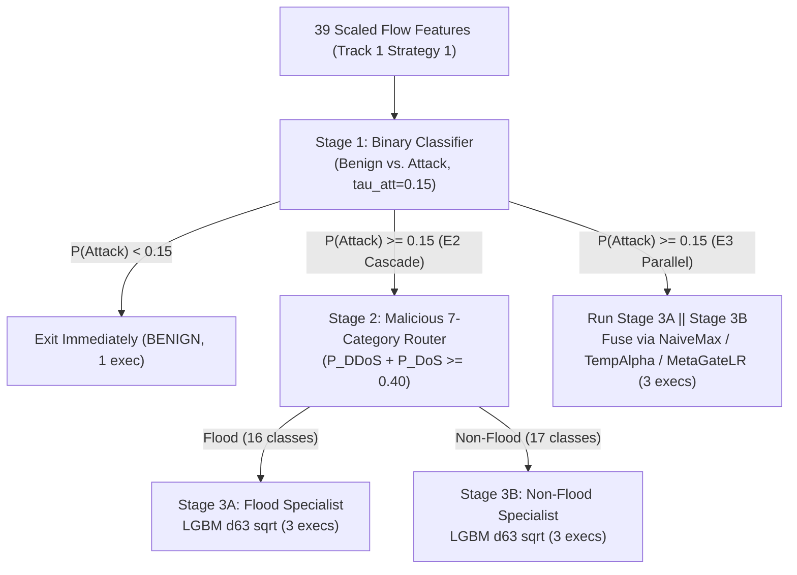

# Hierarchical & Specialized Multi-Stage IDS Architecture (E1–E4 Comparison)

> **Status**: **Implemented & Evaluated** (Completed November 2026 under Track 2).  
> **Track**: Track 2 — Practical Intrusion Detection System Engineering ([`track2_ids_engineering/`](../))  
> **Upstream Read-Only Reference**: Track 1 — Dataset Integrity & Flat Baselines ([`track1_dataset_evaluation/`](../../track1_dataset_evaluation/))  
> **Full Technical Report**: [`docs/COMPARISON_REPORT.md`](docs/COMPARISON_REPORT.md)

---

## 1. Architecture Overview (E1, E2, E3, E4)

We experimentally compare four 34-class intrusion detection architectures on Track 1's leakage-free Strategy 1 partitions (`Train = 350,821`, `Validation = 75,172`, `Internal Test = 75,105`) and the disjoint same-testbed holdout (`Cross-Capture Clean = 57,280`):

- **E1 (`E1_Flat34_LGBM_Balanced`)**: Reuses Track 1's existing flat 34-class LightGBM (`n_estimators=100, num_leaves=31, balanced`) strictly read-only (`E1_Ref_Unweighted_Track1` also evaluated).
- **E2 (`HierarchicalCascade3Stage`)**: Stage 1 Binary filter (`Benign` vs. `Attack`, tunable threshold `tau_att`) -> Stage 2 Malicious-Only 7-Category router (`DDoS`/`DoS` vs. 5 non-flood categories, threshold `f_tau`) -> Stage 3A 16-Class Volumetric Flood specialist or Stage 3B 17-Class Non-Flood specialist.
- **E3 (`ParallelSpecialistFusion`)**: Stage 1 Binary filter -> runs Stage 3A and Stage 3B in parallel -> three score-fusion strategies (`NaiveMax`, temperature-scaled static `TempAlpha`, and `MetaGate` Logistic Regression over specialist confidence summaries).
- **E4 (`E4_LGBM_Leaves63_Sqrt`)**: Improved flat 34-class LightGBM (`n_estimators=150, num_leaves=63, sqrt_balanced`), trained and calibrated on Validation across weighting and prior-bias ablations.



---

## 2. Repository Module Layout

```
track2_ids_engineering/hierarchical_ids/
├── README.md                          # Overview, results summary, reproduction commands
├── docs/
│   └── COMPARISON_REPORT.md           # Full E1-E4 experimental & error analysis report
├── src/
│   ├── data_utils.py                  # Read-only Track 1 loader, 16/17 class mapping, weight schemes
│   ├── architectures.py               # E1/E4 flat wrapper, E2 cascade, E3 parallel fusion + trace
│   └── metrics_eval.py                # End-to-end 34-class metrics, error decomposition & latency
├── experiments/
│   ├── train_and_tune_val.py          # Train Stage 2/3A/3B/E4 & tune E2/E3/E4 strictly on Train+Val
│   └── run_final_evaluation.py        # Frozen read-only evaluation on Val, Internal Test & Cross-Capture
├── models/                            # 18 saved Track 2 model checkpoints (.joblib)
└── results/
    ├── frozen_architectures_config.json
    ├── val_component_benchmarks.csv
    ├── val_e2_e3_sweeps.csv
    ├── val_e4_candidates.csv
    ├── final_comparison_{val,test,cross}.csv
    ├── per_class_metrics_{val,test,cross}.csv
    ├── minority_attack_comparison_{val,test,cross}.csv
    ├── error_attribution_{val,test,cross}.csv
    ├── stage_diagnostics_{val,test,cross}.json
    ├── pairwise_error_analysis_{test,cross}.json
    └── confusion_matrices/*.npy         # 34x34 raw confusion matrices (8 archs x 3 splits)
```

---

## 3. Summary Results & Core Findings

### Frozen Architecture Comparison (Internal Test `N=75,105` & Cross-Capture `N=57,280`)

| Architecture | Origin | Val Macro-F1 (N=75,172) | Test Acc (N=75,105) | Test Macro-F1 | Test MCC | Test Minority F1 (Rec) | Cross Acc (N=57,280) | Cross Macro-F1 | Cross MCC | Single-Flow P50 (Test) | Execs / Flow |
| :--- | :--- | :---: | :---: | :---: | :---: | :---: | :---: | :---: | :---: | :---: | :---: |
| `E1_Flat34_LGBM_Balanced` | Reused Track 1 | 0.6142 | 72.65% | 0.6145 | 0.7170 | 0.1624 (**0.3360**) | 69.64% | **0.6498** | 0.6861 | **3.43 ms** | 1.00 |
| `E2_Cascade_Default_T050` | Reused S1 + New S2/3 | 0.6196 | 73.59% | 0.6185 | 0.7289 | 0.2115 (0.1519) | 68.61% | 0.6213 | 0.6818 | 7.88 ms | 2.63 |
| `E2_Cascade_ValTuned` | Reused S1 + New S2/3 | **0.6394** | 75.04% | **0.6361** | 0.7405 | **0.2264** (0.2094) | 70.50% | 0.6453 | 0.6949 | 53.30 ms* | 2.82 |
| `E3_Parallel_NaiveMax` | Reused S1 + New 3A/3B | 0.4389 | 56.11% | 0.4389 | 0.5567 | 0.1757 (0.1084) | 53.26% | 0.4360 | 0.5261 | 49.73 ms* | 2.82 |
| `E3_Parallel_MetaGate` | Reused S1 + New Gate | 0.6267 | 73.78% | 0.6239 | 0.7275 | 0.2253 (0.2094) | 69.41% | 0.6327 | 0.6837 | 52.40 ms* | 2.82 |
| `E4_LGBM_Leaves63_Sqrt` | New Track 2 | 0.6358 | **75.37%** | 0.6352 | **0.7440** | 0.2196 (0.2063) | **70.72%** | 0.6441 | **0.6972** | 4.15 ms | 1.00 |

*\*Uses Track 1 `binary_random_forest.joblib` (`n_jobs=-1`), creating per-query thread-dispatch latency in single-flow mode while keeping `8,042.5 fps` batch throughput.*

### Takeaways & Limitations
1. **Capacity + `sqrt_balanced` weighting drove most gains**: Improved flat **`E4_LGBM_Leaves63_Sqrt`** essentially matches **`E2_Cascade_ValTuned`** (`0.6352` vs. `0.6361` Test Macro-F1; `0.6441` vs. `0.6453` Cross) while winning overall **Accuracy**, **MCC**, **Benign Recall**, **12.8× faster single-flow P50**, and **1.0 execution/flow**.
2. **Stage 2 routing is not the bottleneck**: `stage2_cat7_lgbm_sqrt_balanced` achieves `99.98%` Flood recall on Test (`50` Flood/Non-Flood misroutes out of `75,105`), and E4 flat trees achieve `46` cross-family errors internally. Residual confusion stems from indistinguishable single-flow features (`DDoS` vs. `DoS`, `SYN` vs. `SynonymousIP`, `RECON-OSSCAN` vs. `BENIGN`).
3. **E3 needs a learned family gate**: Both closed-world specialists fire at `>= 0.50` simultaneously on `76.16%` of passed Test attacks (`NaiveMax` = `0.4389` Macro-F1), which `MetaGate` partially mitigates (`0.6239` Test Macro-F1) but still lags E2's raw-feature router (`1,053` vs. `50` family errors).
4. **Cross-Capture Clean is prior-shifted same-testbed data**: Because `cross_capture_test_clean.csv` caps each class at ≤2,000 samples, minority share jumps from `2.58%` (Test) to `14.64%` (`5.67×`), favoring Track 1 E1's aggressive `balanced` recall (`0.3495` -> `0.6498` Cross Macro-F1) over `sqrt_balanced` precision.

---

## 4. Reproducing All Experiments

Run sequentially from `C:\Users\priya\Downloads\capstone`:

```powershell
# 1. Verify upstream Track 1 splits remain intact & zero-overlap
.\.venv\Scripts\python.exe -u track1_dataset_evaluation\src\verify_partitions.py

# 2. Train Stage 2/3A/3B/E4 models and tune E2/E3/E4 strictly on Train + Val
.\.venv\Scripts\python.exe -u -m track2_ids_engineering.hierarchical_ids.experiments.train_and_tune_val --phase components
.\.venv\Scripts\python.exe -u -m track2_ids_engineering.hierarchical_ids.experiments.train_and_tune_val --phase e2_e3
.\.venv\Scripts\python.exe -u -m track2_ids_engineering.hierarchical_ids.experiments.train_and_tune_val --phase e4

# 3. Frozen read-only evaluation on Val, Internal Test, and Cross-Capture Clean
.\.venv\Scripts\python.exe -u -m track2_ids_engineering.hierarchical_ids.experiments.run_final_evaluation
```
