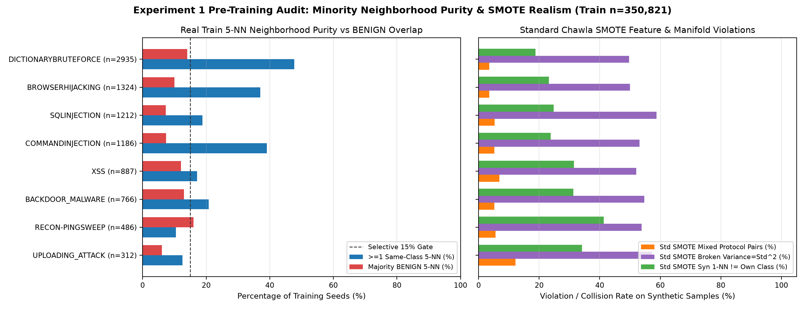
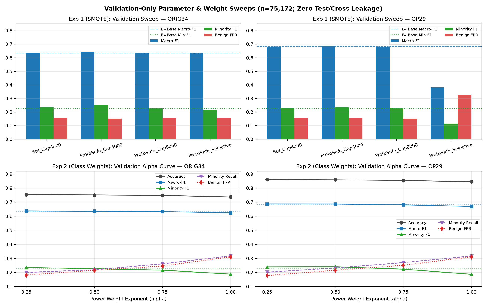
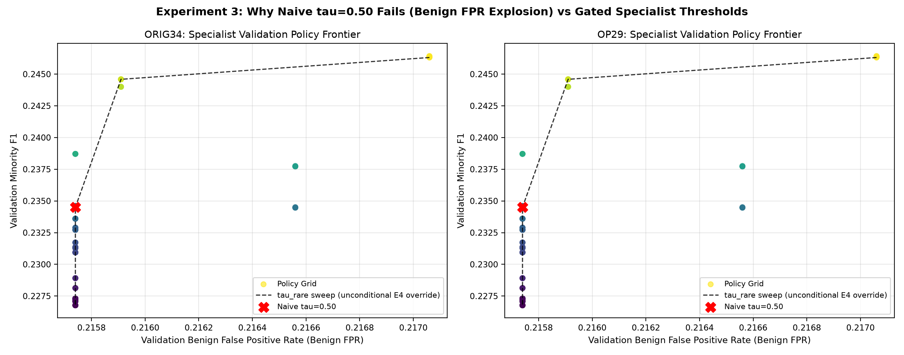
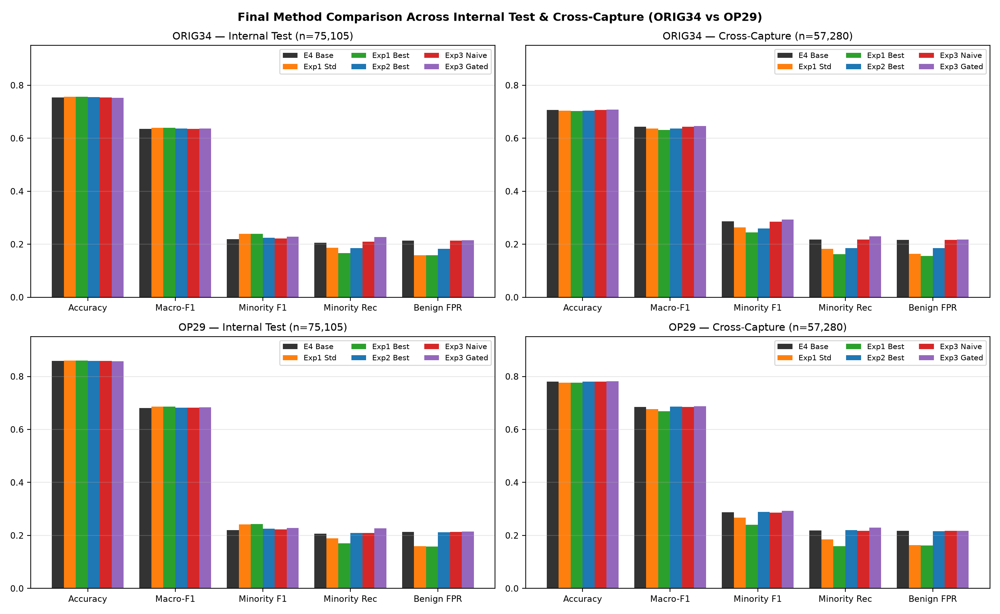
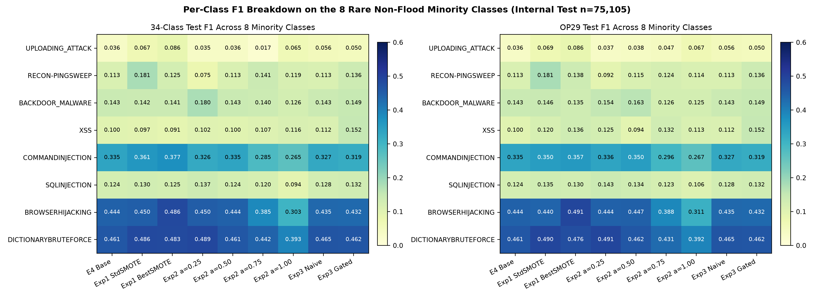

# Controlled Minority-Class Optimization Report (CICIoT2023 IDS — 34-Class & OP29)

> **Scope & Constraint Compliance**: All experiments were executed strictly inside [`track2_ids_engineering/minority_optimization/`](file:///C:/Users/priya/Downloads/capstone/track2_ids_engineering/minority_optimization) using fixed random seed `42` and the exact pre-existing deduplicated dataset partitions (`Train=350,821`, `Val=75,172`, `Internal Test=75,105`, `Cross-Capture=57,280`). Track 1 (`track1_dataset_evaluation/`), historical E1–E4 checkpoints (`track2_ids_engineering/hierarchical_ids/`), Internal Test, and Cross-Capture were never altered or used for training/tuning/selection.

---

## Executive Overview

Three controlled optimization strategies—**(1) Train-only SMOTE**, **(2) Isolated Class-Weight Power Scaling**, and **(3) A Flood-Free Rare-Attack Two-Stage Specialist**—were evaluated against the **E4 Hierarchical LightGBM Baseline** on both the original **34-class (`ORIG34`)** taxonomy and the operational **29-class (`OP29`)** flood-merged taxonomy.

Key takeaways:
1. **No single model dominates both distributions.** On **Internal Test** (`n=75,105`), **Experiment 1 (`Exp1_SMOTE_ProtoSafe_Cap4000`)** achieves the highest Minority F1 (`0.23920` on 34-class; `0.24361` on OP29), highest Macro-F1 (`0.63977` / `0.68653`, and `0.64001` for `Std_Cap4000_34`), highest Accuracy (`0.75695` / `0.86041`), and lowest Benign FPR (`0.15800` vs Baseline `0.21366`).
2. **SMOTE overfits capture-local feature manifolds.** On **Cross-Capture** (`n=57,280`), `Exp1_SMOTE_ProtoSafe_Cap4000` degrades Minority F1 below E4 (`0.28715 → 0.24503` on 34-class; `→ 0.24024` on OP29) and lowers Cross-Capture Accuracy (`0.70721 → 0.70347` / `0.78043 → 0.77593`). Pre-training audits show standard Chawla SMOTE generates `3.48%–12.18%` mixed-protocol pairs, breaks `Variance = Std²` on `49.67%–58.75%` of synthetic rows, and produces `18.78%–41.33%` 1-NN class collisions.
3. **Aggressive class weighting (`α ≥ 0.75`) shifts precision into recall.** `Exp2_Balanced_a100` reaches the highest Minority Recall (`0.30493` Internal Test, `0.30969` Cross-Capture on 34-class) and highest Cross-Capture Minority F1 (`0.31929` 34-class / `0.31301` OP29) and Macro-F1 (`0.65232` / `0.69470`), but inflates Benign FPR from `0.21366` to `0.31434` (`+606` false alarms on Internal Test) and drops Internal Test Minority F1 to `0.18501`.
4. **The Flood-Free Specialist (`Exp3_Hybrid_Gated`) is the only method improving both Internal Test and Cross-Capture Macro-F1 and Minority F1 simultaneously.** Because E4's flood gating leaks **0** true rare flows into Flood predictions (`0 / 1,844` Val, `0 / 1,939` Test, `0 / 8,384` Cross), the gated Stage A + Stage B specialist raises 34-class Minority F1 from `0.21957 → 0.22882` (Test) and `0.28715 → 0.29297` (Cross), OP29 Macro-F1 from `0.68088 → 0.68335` (Test) and `0.68535 → 0.68779` (Cross), while changing accuracy by `< 0.06%` and Benign FPR by `+0.08%`.
5. **OP29 provides a structural `+10.4 pp` accuracy and `+4.5 pp` Macro-F1 boost** (`0.75366 → 0.85809` Test Accuracy; `0.63523 → 0.68088` Test Macro-F1 on E4) by merging interchangeable HTTP/SYN/TCP/UDP Flood subtypes, without altering the underlying non-flood minority detection difficulty (`Minority F1` remains `0.21957` on E4).

---

## 1. Phase 1: Dataset Audit, Features & Baselines

### 1.1 Dataset Integrity & Collision Audit
Verified via [`run_phase1_inspection.py`](file:///C:/Users/priya/Downloads/capstone/track2_ids_engineering/minority_optimization/scripts/run_phase1_inspection.py) and [`experiment_plan.json`](file:///C:/Users/priya/Downloads/capstone/track2_ids_engineering/minority_optimization/configs/experiment_plan.json):
- **Original stratified CICIoT2023 sample size**: `529,562` flows
- **Rows after exact duplicate removal**: `501,098` (`28,464` exact duplicates removed)
- **Unique feature vectors**: `491,422`
- **Conflicting-label collision groups**: `8,740` feature-hash collisions carrying multiple labels (structural separability ceiling across packet-aggregated statistics)
- **Exact Partition Counts (Unchanged)**:
  - **Training**: `350,821`
  - **Validation**: `75,172`
  - **Internal Test**: `75,105`
  - **Cross-Capture (Clean / Raw Extracted)**: `57,280` / `63,423` (evaluated strictly on the deduplicated clean Cross-Capture split of `57,280`)

### 1.2 Exact 39 Input Features
`Header_Length`, `Protocol Type`, `Time_To_Live`, `Rate`, `fin_flag_number`, `syn_flag_number`, `rst_flag_number`, `psh_flag_number`, `ack_flag_number`, `ece_flag_number`, `cwr_flag_number`, `ack_count`, `syn_count`, `fin_count`, `rst_count`, `HTTP`, `HTTPS`, `DNS`, `Telnet`, `SMTP`, `SSH`, `IRC`, `TCP`, `UDP`, `DHCP`, `ARP`, `ICMP`, `IGMP`, `IPv`, `LLC`, `Tot sum`, `Min`, `Max`, `AVG`, `Std`, `Tot size`, `IAT`, `Number`, `Variance`.

### 1.3 Eight Minority Classes Used for Minority F1
Exact `Minority F1` / `Minority Recall` definition extracted from existing E4 evaluation (`macro average across the 8 rare non-flood web/brute/recon classes`):
1. `UPLOADING_ATTACK` (`312` Train)
2. `RECON-PINGSWEEP` (`486` Train)
3. `BACKDOOR_MALWARE` (`766` Train)
4. `XSS` (`887` Train)
5. `COMMANDINJECTION` (`1,186` Train)
6. `SQLINJECTION` (`1,212` Train)
7. `BROWSERHIJACKING` (`1,324` Train)
8. `DICTIONARYBRUTEFORCE` (`2,935` Train)

Total rare-8 minority rows: `9,108` in Training (`2.60%` of `350,821`), `1,844` in Validation, `1,939` in Internal Test, and `8,384` in Cross-Capture.

### 1.4 Full 34-Class & OP29 Partition Distributions

Complete 34-Class Sample Counts Across All Partitions (click to expand)

| Class (34) | Category (8) | OP29 Mapping | Family | Min-8 | Raw Sample | Clean Total | Train | Val | Internal Test | Cross-Capture |
| :--- | :--- | :--- | :--- | :---: | ---: | ---: | ---: | ---: | ---: | ---: |
| `BACKDOOR_MALWARE` | Web | `BACKDOOR_MALWARE` | Non-Flood | Yes | 1,061 | 1,060 | 766 | 155 | 139 | 729 |
| `BENIGN` | Benign | `BENIGN` | Benign | No | 40,000 | 39,960 | 27,855 | 6,086 | 6,019 | 4,982 |
| `BROWSERHIJACKING` | Web | `BROWSERHIJACKING` | Non-Flood | Yes | 1,904 | 1,889 | 1,324 | 271 | 294 | 1,320 |
| `COMMANDINJECTION` | Web | `COMMANDINJECTION` | Non-Flood | Yes | 1,666 | 1,666 | 1,186 | 225 | 255 | 1,322 |
| `DDOS-ACK_FRAGMENTATION` | DDoS | `DDOS-ACK_FRAGMENTATION` | Flood | No | 20,000 | 19,989 | 13,968 | 3,053 | 2,968 | 2,000 |
| `DDOS-HTTP_FLOOD` | DDoS | `FLOOD_HTTP` | Flood | No | 9,121 | 9,121 | 6,395 | 1,424 | 1,302 | 2,000 |
| `DDOS-ICMP_FLOOD` | DDoS | `DDOS-ICMP_FLOOD` | Flood | No | 20,000 | 16,628 | 11,639 | 2,485 | 2,504 | 1,428 |
| `DDOS-ICMP_FRAGMENTATION` | DDoS | `DDOS-ICMP_FRAGMENTATION` | Flood | No | 20,000 | 19,993 | 14,029 | 2,947 | 3,017 | 2,000 |
| `DDOS-PSHACK_FLOOD` | DDoS | `DDOS-PSHACK_FLOOD` | Flood | No | 20,000 | 17,714 | 12,435 | 2,598 | 2,681 | 1,592 |
| `DDOS-RSTFINFLOOD` | DDoS | `DDOS-RSTFINFLOOD` | Flood | No | 20,000 | 17,101 | 11,804 | 2,642 | 2,655 | 1,463 |
| `DDOS-SLOWLORIS` | DDoS | `DDOS-SLOWLORIS` | Flood | No | 7,534 | 7,534 | 5,273 | 1,102 | 1,159 | 2,000 |
| `DDOS-SYNONYMOUSIP_FLOOD` | DDoS | `FLOOD_SYN` | Flood | No | 20,000 | 17,253 | 12,184 | 2,610 | 2,459 | 1,273 |
| `DDOS-SYN_FLOOD` | DDoS | `FLOOD_SYN` | Flood | No | 20,000 | 17,690 | 12,374 | 2,686 | 2,630 | 1,368 |
| `DDOS-TCP_FLOOD` | DDoS | `FLOOD_TCP` | Flood | No | 20,000 | 16,539 | 11,585 | 2,503 | 2,451 | 1,273 |
| `DDOS-UDP_FLOOD` | DDoS | `FLOOD_UDP` | Flood | No | 20,000 | 17,375 | 12,148 | 2,593 | 2,634 | 1,442 |
| `DDOS-UDP_FRAGMENTATION` | DDoS | `DDOS-UDP_FRAGMENTATION` | Flood | No | 20,000 | 19,991 | 13,956 | 3,031 | 3,004 | 2,000 |
| `DICTIONARYBRUTEFORCE` | BruteForce | `DICTIONARYBRUTEFORCE` | Non-Flood | Yes | 4,181 | 4,181 | 2,935 | 617 | 629 | 1,999 |
| `DNS_SPOOFING` | Spoofing | `DNS_SPOOFING` | Non-Flood | No | 20,000 | 19,675 | 13,733 | 2,905 | 3,037 | 1,948 |
| `DOS-HTTP_FLOOD` | DoS | `FLOOD_HTTP` | Flood | No | 20,000 | 19,955 | 14,040 | 2,973 | 2,942 | 1,996 |
| `DOS-SYN_FLOOD` | DoS | `FLOOD_SYN` | Flood | No | 20,000 | 18,072 | 12,579 | 2,738 | 2,755 | 1,447 |
| `DOS-TCP_FLOOD` | DoS | `FLOOD_TCP` | Flood | No | 20,000 | 17,249 | 12,025 | 2,597 | 2,627 | 1,374 |
| `DOS-UDP_FLOOD` | DoS | `FLOOD_UDP` | Flood | No | 20,000 | 18,355 | 12,854 | 2,778 | 2,723 | 1,591 |
| `MIRAI-GREETH_FLOOD` | Mirai | `MIRAI-GREETH_FLOOD` | Non-Flood | No | 20,000 | 19,942 | 14,072 | 2,912 | 2,958 | 1,988 |
| `MIRAI-GREIP_FLOOD` | Mirai | `MIRAI-GREIP_FLOOD` | Non-Flood | No | 20,000 | 19,965 | 13,887 | 2,992 | 3,086 | 1,994 |
| `MIRAI-UDPPLAIN` | Mirai | `MIRAI-UDPPLAIN` | Non-Flood | No | 20,000 | 19,912 | 14,004 | 2,959 | 2,949 | 1,985 |
| `MITM-ARPSPOOFING` | Spoofing | `MITM-ARPSPOOFING` | Non-Flood | No | 20,000 | 18,721 | 13,206 | 2,752 | 2,763 | 1,847 |
| `RECON-HOSTDISCOVERY` | Recon | `RECON-HOSTDISCOVERY` | Non-Flood | No | 20,000 | 19,930 | 14,010 | 2,989 | 2,931 | 1,983 |
| `RECON-OSSCAN` | Recon | `RECON-OSSCAN` | Non-Flood | No | 20,000 | 19,815 | 13,895 | 2,952 | 2,968 | 1,969 |
| `RECON-PINGSWEEP` | Recon | `RECON-PINGSWEEP` | Non-Flood | Yes | 722 | 722 | 486 | 111 | 125 | 567 |
| `RECON-PORTSCAN` | Recon | `RECON-PORTSCAN` | Non-Flood | No | 20,000 | 19,749 | 13,790 | 3,009 | 2,950 | 1,959 |
| `SQLINJECTION` | Web | `SQLINJECTION` | Non-Flood | Yes | 1,718 | 1,718 | 1,212 | 252 | 254 | 1,233 |
| `UPLOADING_ATTACK` | Web | `UPLOADING_ATTACK` | Non-Flood | Yes | 416 | 416 | 312 | 44 | 60 | 289 |
| `VULNERABILITYSCAN` | Recon | `VULNERABILITYSCAN` | Non-Flood | No | 20,000 | 19,979 | 13,973 | 3,012 | 2,994 | 1,994 |
| `XSS` | Web | `XSS` | Non-Flood | Yes | 1,239 | 1,239 | 887 | 169 | 183 | 925 |
| **Total** | **8 Categories** | **29 OP29 Classes** | — | **8 Rare** | **529,562** | **501,098** | **350,821** | **75,172** | **75,105** | **57,280** |

OP29 Merged Flood Classes (9 raw flood classes → 4 operational super-classes) (click to expand)

| OP29 Super-Class | Merged From (`n`) | Source 34-Class Labels | Train | Val | Internal Test | Cross-Capture |
| :--- | :---: | :--- | ---: | ---: | ---: | ---: |
| `FLOOD_HTTP` | 2 | `DDOS-HTTP_FLOOD` \| `DOS-HTTP_FLOOD` | 20,435 | 4,397 | 4,244 | 3,996 |
| `FLOOD_SYN` | 3 | `DDOS-SYNONYMOUSIP_FLOOD` \| `DDOS-SYN_FLOOD` \| `DOS-SYN_FLOOD` | 37,137 | 8,034 | 7,844 | 4,088 |
| `FLOOD_TCP` | 2 | `DDOS-TCP_FLOOD` \| `DOS-TCP_FLOOD` | 23,610 | 5,100 | 5,078 | 2,647 |
| `FLOOD_UDP` | 2 | `DDOS-UDP_FLOOD` \| `DOS-UDP_FLOOD` | 25,002 | 5,371 | 5,357 | 3,033 |

All remaining 25 classes retain identical 1-to-1 mappings between `ORIG34` and `OP29` ([`phase1_class_distribution_op29.csv`](file:///C:/Users/priya/Downloads/capstone/track2_ids_engineering/minority_optimization/results/phase1_class_distribution_op29.csv)).

---

## 2. Controlled Experiment Designs & Validation Selection

Every candidate uses LightGBM base parameters `n_estimators=150, learning_rate=0.05, num_leaves=63, random_state=42`. Selection strictly enforced the Validation guardrail: `(benign_fpr <= 0.25) AND (accuracy >= baseline_val_acc - 0.03)`.

### 2.1 Experiment 1: Train-Only SMOTE & Realism Audit
Script: [`run_exp1_smote.py`](file:///C:/Users/priya/Downloads/capstone/track2_ids_engineering/minority_optimization/scripts/run_exp1_smote.py) | Selected config: [`exp1_selected_smote.json`](file:///C:/Users/priya/Downloads/capstone/track2_ids_engineering/minority_optimization/configs/exp1_selected_smote.json) | Audit table: [`exp1_smote_realism_audit.csv`](file:///C:/Users/priya/Downloads/capstone/track2_ids_engineering/minority_optimization/results/exp1_smote_realism_audit.csv)

#### Pre-Training Realism Audit (`Train n = 350,821`)
| Minority Class | Train Count | Real 5-NN Same-Class Mean | Seeds ≥1 Same-Class 5-NN (%) | Std SMOTE Mixed-Protocol Pairs (%) | Std SMOTE Broken `Var = Std²` (%) | Std SMOTE Syn 1-NN Collision (%) | ProtoSafe Syn 1-NN Collision (%) |
| :--- | ---: | ---: | ---: | ---: | ---: | ---: | ---: |
| `UPLOADING_ATTACK` | 312 | 0.0256 | 12.50% | 12.18% | 57.28% | 34.11% | 37.00% |
| `RECON-PINGSWEEP` | 486 | 0.0280 | 10.49% | 5.61% | 53.82% | 41.33% | 40.83% |
| `BACKDOOR_MALWARE` | 766 | 0.0843 | 20.76% | 5.16% | 54.73% | 31.32% | 29.07% |
| `XSS` | 887 | 0.0428 | 17.14% | 6.84% | 52.10% | 31.48% | 33.50% |
| `COMMANDINJECTION` | 1,186 | 0.2300 | 39.04% | 5.22% | 53.16% | 23.81% | 23.49% |
| `SQLINJECTION` | 1,212 | 0.0591 | 18.81% | 5.34% | 58.75% | 24.75% | 25.25% |
| `BROWSERHIJACKING` | 1,324 | 0.1876 | 37.01% | 3.48% | 50.00% | 23.24% | 24.18% |
| `DICTIONARYBRUTEFORCE` | 2,935 | 0.2933 | 47.67% | 3.57% | 49.67% | 18.78% | 17.46% |

- **Why Standard Chawla SMOTE fails realism checks**: Even on real training rows, `87.5%` of `UPLOADING_ATTACK` and `89.51%` of `RECON-PINGSWEEP` points have **zero** same-class neighbors among their 5 nearest neighbors in the full 350,821-row training pool. Linearly interpolating between distant seeds violates physical invariants: `3.48%–12.18%` cross `Protocol Type` boundaries and `49.67%–58.75%` break `Variance = Std²`. Even after within-protocol stratification and algebraic repair (`SMOTE_ProtoSafe`), `17.46%–40.83%` of synthetic rows still fall closest (`1-NN`) to a **non-target class** (chiefly `BENIGN` or common Web/Recon traffic).
- **Four SMOTE Candidates Evaluated (Unweighted, `α = 0.0`, Train-Only)**:
  1. `SMOTE_Std_Cap4000` (`+21,276` rows → `372,097` train rows): Standard linear 5-NN SMOTE on all 8 classes capped at `min(4000, 8×n_c)`.
  2. `SMOTE_ProtoSafe_Cap4000` (`+21,276` rows → `372,097`): Within-`Protocol Type` 5-NN + invariant repair, same cap. **Selected on Validation** for both `ORIG34` (`Val Acc=0.75520, MacroF1=0.64214, MinF1=0.25322, BenFPR=0.15150`) and `OP29` (`Val Acc=0.86166, MacroF1=0.68420, MinF1=0.23336, BenFPR=0.15396`).
  3. `SMOTE_ProtoSafe_Cap8000` (`+46,532` rows → `397,353`): Higher cap `min(8000, 10×n_c)`. Validation `MinF1` dropped (`0.22750` on 34-class; `0.22901` on OP29) due to redundant/colliding synthetic density.
  4. `SMOTE_ProtoSafe_Selective` (`+27,691` rows → `378,512`): Skipped `UPLOADING_ATTACK` (`12.50% < 15%`) and `RECON-PINGSWEEP` (`10.49% < 15%`) and filtered isolated outlier seeds. On OP29, `Exp1_SMOTE_ProtoSafe_Selective_op29` suffered severe multiclass optimization collapse (`Val Acc=0.52031`, `Test Acc=0.51823`), where `DDOS-PSHACK_FLOOD` (`F1=0.00580`), `DDOS-RSTFINFLOOD` (`F1=0.00436`), and `FLOOD_TCP` (`F1=0.00454`) collapsed into `FLOOD_SYN` (`0.96991` recall / `0.35671` precision). Validation gating properly rejected this model.

### 2.2 Experiment 2: Isolated Class-Weight Power Optimization (Zero SMOTE)
Script: [`run_exp2_class_weights.py`](file:///C:/Users/priya/Downloads/capstone/track2_ids_engineering/minority_optimization/scripts/run_exp2_class_weights.py) | Selected config: [`exp2_selected_weights.json`](file:///C:/Users/priya/Downloads/capstone/track2_ids_engineering/minority_optimization/configs/exp2_selected_weights.json)

Power-law sample weights $w_c \propto (N / (K \cdot n_c))^\alpha$ were swept cleanly without oversampling across $\alpha \in \{0.25, 0.50, 0.75, 1.00\}$:
- **`ORIG34`**: Baseline E4 already uses `alpha=0.50` (`Exp2_SqrtBalanced_a050_34` reproduces `E4_Baseline_34` exactly: `Val Acc=0.75133, MacroF1=0.63576, MinF1=0.22709`). Max/min class-weight ratios span `3.07×` (`a=0.25`), `9.45×` (`a=0.50`), `29.04×` (`a=0.75`), and `89.28×` (`a=1.00`). Validation selected **`Exp2_Power_a025_34`** (`α=0.25`, `Val Acc=0.75342, MacroF1=0.63802, MinF1=0.23608, BenFPR=0.18156`).
- **`OP29`**: Max-to-min weight ratio under `Balanced_a100` widens to `119.0×` (`UPLOADING_ATTACK=7.7718` vs merged `FLOOD_SYN=0.0653`). Validation selected **`Exp2_SqrtBalanced_a050_op29`** (`α=0.50`, `Val Acc=0.85926, MacroF1=0.68692, MinF1=0.24124, BenFPR=0.21574`).
- **Sweeping `α` exposes an irreversible precision–recall frontier**: `α < 0.50` improves overall accuracy and slashes Benign FPR (`18.2%`), whereas `α = 0.75 / 1.00` boosts Validation Minority Recall to `0.26221 / 0.31785` (ORIG34) while driving Benign FPR up to `0.24663 / 0.31170` (`α=1.00` violates the `benign_fpr <= 0.25` guardrail).

### 2.3 Experiment 3: Flood-Free Rare Non-Flood Specialist (Zero Flood Training)
Script: [`run_exp3_specialist.py`](file:///C:/Users/priya/Downloads/capstone/track2_ids_engineering/minority_optimization/scripts/run_exp3_specialist.py) | Selected config: [`exp3_selected_policies.json`](file:///C:/Users/priya/Downloads/capstone/track2_ids_engineering/minority_optimization/configs/exp3_selected_policies.json)

Trained strictly on the **non-flood training subset** (`161,533` rows: `9,108` Rare-8 positives vs `152,425` `BENIGN` + common non-flood negatives; **0 flood packets**):
1. **Stage A (Binary Rare-vs-NonRare Detector)**: Selected **`StageA_Bin_unweighted`** (`α=0.0`, `0.444 MB`), reaching Validation Non-Flood PR-AUC `0.51752` / ROC-AUC `0.91494` and Full-Val ROC-AUC `0.96219` with only `0.00169` Non-Flood FPR (`0.00002` on Floods).
2. **Stage B (8-Class Rare Classifier Oracle)**: Selected **`StageB_Rare8_sqrt_a050`** (`α=0.50`, `3.545 MB`), achieving Validation Oracle 8-class `Accuracy=0.55098`, `Macro-F1=0.43647`, `MCC=0.44295`.
3. **Hybrid Inference Gating vs Naive Thresholding**:
   - **Flood Bypass Safety**: Flows predicted by E4 as Flood bypass the specialist. Across all splits, **0 true rare flows were ever misrouted to E4 Flood** (`true_rare_bypassed_by_e4_flood = 0` on Val `1,844/1,844`, Test `1,939/1,939`, Cross `8,384/8,384`).
   - **Naive (`Exp3_Hybrid_Naive`, `τ_rare=0.50, τ_cls=0.0, τ_e4_keep=1.01`)** overrides `465` Val / `525` Test predictions cleanly (`+0.00%` Benign FPR), yielding tiny gains (`Test MinF1 0.21957 → 0.22247`).
   - **Validation-Tuned Gated (`Exp3_Hybrid_Gated`, `τ_rare=0.30, τ_cls=0.25, τ_e4_keep=0.65`)** overrides E4 only when Stage A signals rare probability `≥ 0.30`, Stage B top class confidence `≥ 0.25`, and E4's confidence `< 0.65`. On Test it overrides `1,082` routed non-flood flows (`54` wrong→right fixes vs `92` right→wrong flips across all classes, only `5` Benign→Rare FPs); on Cross-Capture it overrides `3,242` flows with a large positive flip ratio (`245` wrong→right fixes vs `180` right→wrong flips, only `3` Benign→Rare FPs!).

---

## 3. Phase 4 Comparative Evaluation

All models were evaluated read-only by [`run_phase4_evaluation.py`](file:///C:/Users/priya/Downloads/capstone/track2_ids_engineering/minority_optimization/scripts/run_phase4_evaluation.py) on **Validation (`75,172`)**, **Internal Test (`75,105`)**, and **Cross-Capture (`57,280`)**, with single-flow latency (`p50`/`p95` across `200` runs after `25` warmups) and batch throughput measured on **Internal Test**.

### 3.1 Original 34-Class Classification (`ORIG34`, 34 Classes)

Source: [`phase4_summary_34.csv`](file:///C:/Users/priya/Downloads/capstone/track2_ids_engineering/minority_optimization/results/phase4_summary_34.csv) (*`*` = Validation-selected within experiment*)

#### Validation (`n = 75,172`) & Internal Test (`n = 75,105`) — `ORIG34`
| Model (`ORIG34`) | Val Acc | Val MacroF1 | Val MinF1 | Val BenFPR | Test Acc | Test MacroF1 | Test WtdF1 | Test MCC | Test MinF1 | Test MinRec | Test BenRec | Test BenFPR | Test Att→Ben FNR | P50 (ms) | P95 (ms) | Batch FPS | Size (MB) |
| :--- | ---: | ---: | ---: | ---: | ---: | ---: | ---: | ---: | ---: | ---: | ---: | ---: | ---: | ---: | ---: | ---: | ---: |
| `E4_Baseline_34`* | 0.75133 | 0.63576 | 0.22709 | 0.21574 | 0.75366 | 0.63523 | 0.74721 | 0.74402 | 0.21957 | 0.20631 | 0.78634 | 0.21366 | 0.03444 | **3.409** | **4.169** | **7,520.8** | 33.895 |
| `Exp1_SMOTE_Std_Cap4000_34` | 0.75282 | 0.63642 | 0.23370 | 0.15675 | 0.75635 | **0.64001** | 0.74756 | 0.74684 | **0.23928** | 0.18723 | 0.84134 | 0.15866 | 0.04506 | 5.136 | 6.157 | 5,936.1 | 15.454 |
| `Exp1_SMOTE_ProtoSafe_Cap4000_34`* | **0.75520** | **0.64214** | **0.25322** | **0.15150** | **0.75695** | 0.63977 | 0.74727 | **0.74743** | 0.23920 | 0.16710 | 0.84200 | 0.15800 | 0.04577 | 4.738 | 5.544 | 6,018.6 | 15.428 |
| `Exp1_SMOTE_ProtoSafe_Cap8000_34` | 0.75431 | 0.63535 | 0.22750 | 0.15429 | 0.75663 | 0.63925 | 0.74674 | 0.74711 | 0.23853 | 0.16491 | **0.84433** | **0.15567** | 0.04616 | 5.413 | 6.480 | 4,556.1 | 15.448 |
| `Exp1_SMOTE_ProtoSafe_Selective_34` | 0.75419 | 0.63294 | 0.21570 | 0.15495 | 0.75629 | 0.63570 | 0.74677 | 0.74674 | 0.22296 | 0.16059 | 0.84316 | 0.15684 | 0.04571 | 5.658 | 6.848 | 5,446.7 | 15.420 |
| `Exp2_Power_a025_34`* | 0.75342 | 0.63802 | 0.23608 | 0.18156 | 0.75550 | 0.63662 | **0.74767** | 0.74590 | 0.22422 | 0.18585 | 0.81758 | 0.18242 | 0.03981 | 5.167 | 6.041 | 4,915.4 | **15.364** |
| `Exp2_SqrtBalanced_a050_34` | 0.75133 | 0.63576 | 0.22709 | 0.21574 | 0.75366 | 0.63523 | 0.74721 | 0.74402 | 0.21957 | 0.20631 | 0.78634 | 0.21366 | 0.03444 | 4.171 | 4.830 | 5,419.9 | 15.369 |
| `Exp2_Power_a075_34` | 0.74824 | 0.63343 | 0.21681 | 0.24663 | 0.74811 | 0.63051 | 0.74485 | 0.73836 | 0.20470 | 0.24497 | 0.74414 | 0.25586 | 0.02935 | 4.688 | 5.622 | 4,344.7 | 15.372 |
| `Exp2_Balanced_a100_34` | 0.73698 | 0.62404 | 0.18823 | 0.31170 | 0.73914 | 0.62452 | 0.74168 | 0.72949 | 0.18501 | **0.30493** | 0.68566 | 0.31434 | **0.02322** | 5.232 | 6.352 | 4,621.4 | 15.390 |
| `Exp3_Hybrid_Naive_34` | 0.75145 | 0.63752 | 0.23450 | 0.21574 | 0.75364 | 0.63591 | 0.74725 | 0.74399 | 0.22247 | 0.20970 | 0.78634 | 0.21366 | 0.03438 | 5.513 | 9.228 | 4,399.5 | 37.884 |
| `Exp3_Hybrid_Gated_34`* | 0.75118 | 0.64032 | 0.24643 | 0.21706 | 0.75316 | 0.63733 | 0.74723 | 0.74351 | 0.22882 | 0.22681 | 0.78551 | 0.21449 | 0.03429 | 5.856 | 9.547 | 5,239.5 | 37.884 |

#### Cross-Capture Generalization (`n = 57,280`) — `ORIG34`
| Model (`ORIG34`) | Cross Acc | Cross MacroF1 | Cross WtdF1 | Cross MCC | Cross MinF1 | Cross MinRec | Cross Flood MF1 | Cross NF MF1 | Cross BenRec | Cross BenFPR | Cross Att→Ben FNR | Total Errors |
| :--- | ---: | ---: | ---: | ---: | ---: | ---: | ---: | ---: | ---: | ---: | ---: | ---: |
| `E4_Baseline_34`* | 0.70721 | 0.64405 | 0.69703 | 0.69715 | 0.28715 | 0.21835 | 0.80892 | 0.48696 | 0.78322 | 0.21678 | 0.05059 | 16,771 |
| `Exp1_SMOTE_Std_Cap4000_34` | 0.70379 | 0.63711 | 0.68966 | 0.69402 | 0.26408 | 0.18223 | **0.80964** | 0.47385 | 0.83581 | 0.16419 | 0.06933 | 16,967 |
| `Exp1_SMOTE_ProtoSafe_Cap4000_34`* | 0.70347 | 0.63146 | 0.68722 | 0.69390 | 0.24503 | 0.16235 | 0.80791 | 0.46423 | **0.84384** | **0.15616** | 0.07119 | 16,985 |
| `Exp1_SMOTE_ProtoSafe_Cap8000_34` | 0.70215 | 0.62884 | 0.68517 | 0.69258 | 0.23386 | 0.15355 | 0.80773 | 0.45936 | 0.84183 | 0.15817 | 0.07214 | 17,061 |
| `Exp1_SMOTE_ProtoSafe_Selective_34` | 0.70276 | 0.63194 | 0.68720 | 0.69312 | 0.24805 | 0.16638 | 0.80778 | 0.46536 | 0.83701 | 0.16299 | 0.07016 | 17,026 |
| `Exp2_Power_a025_34`* | 0.70431 | 0.63656 | 0.69124 | 0.69442 | 0.25995 | 0.18485 | 0.80906 | 0.47260 | 0.81413 | 0.18587 | 0.06077 | 16,937 |
| `Exp2_SqrtBalanced_a050_34` | 0.70721 | 0.64405 | 0.69703 | 0.69715 | 0.28715 | 0.21835 | 0.80892 | 0.48696 | 0.78322 | 0.21678 | 0.05059 | 16,771 |
| `Exp2_Power_a075_34` | 0.70784 | 0.64965 | 0.70133 | 0.69750 | 0.30641 | 0.25712 | 0.80770 | 0.49893 | 0.74328 | 0.25672 | 0.04128 | 16,735 |
| `Exp2_Balanced_a100_34` | 0.70384 | **0.65232** | **0.70199** | 0.69331 | **0.31929** | **0.30969** | 0.80671 | **0.50531** | 0.68466 | 0.31534 | **0.03100** | 16,964 |
| `Exp3_Hybrid_Naive_34` | 0.70737 | 0.64383 | 0.69728 | 0.69729 | 0.28567 | 0.21807 | 0.80892 | 0.48648 | 0.78322 | 0.21678 | 0.05046 | 16,762 |
| `Exp3_Hybrid_Gated_34`* | **0.70834** | 0.64613 | 0.69886 | **0.69820** | 0.29297 | 0.22996 | 0.80892 | 0.49099 | 0.78262 | 0.21738 | 0.04975 | **16,706** |

---

### 3.2 Operational 29-Class Classification (`OP29`, Merged Floods)

Source: [`phase4_summary_op29.csv`](file:///C:/Users/priya/Downloads/capstone/track2_ids_engineering/minority_optimization/results/phase4_summary_op29.csv) (*`*` = Validation-selected within experiment*)

#### Validation (`n = 75,172`) & Internal Test (`n = 75,105`) — `OP29`
| Model (`OP29`) | Val Acc | Val MacroF1 | Val MinF1 | Val BenFPR | Test Acc | Test MacroF1 | Test WtdF1 | Test MCC | Test MinF1 | Test MinRec | Test BenRec | Test BenFPR | Test Att→Ben FNR | P50 (ms) | P95 (ms) | Batch FPS | Size (MB) |
| :--- | ---: | ---: | ---: | ---: | ---: | ---: | ---: | ---: | ---: | ---: | ---: | ---: | ---: | ---: | ---: | ---: | ---: |
| `E4_Baseline_OP29_Remap`* | 0.85819 | 0.68246 | 0.22709 | 0.21574 | 0.85809 | 0.68088 | 0.85345 | 0.85042 | 0.21957 | 0.20631 | 0.78634 | 0.21366 | 0.03444 | 5.629 | 7.097 | 4,994.5 | 33.895 |
| `Exp1_SMOTE_Std_Cap4000_op29` | 0.86056 | 0.68298 | 0.23041 | 0.15445 | 0.85988 | 0.68619 | 0.85278 | 0.85248 | 0.24145 | 0.18906 | 0.84051 | 0.15949 | 0.04506 | 4.397 | **5.298** | **6,336.4** | 13.188 |
| `Exp1_SMOTE_ProtoSafe_Cap4000_op29`* | 0.86166 | 0.68420 | 0.23336 | 0.15396 | 0.86041 | **0.68653** | 0.85249 | 0.85305 | **0.24361** | 0.16991 | 0.84200 | 0.15800 | 0.04557 | 5.015 | 5.722 | 5,684.3 | 13.159 |
| `Exp1_SMOTE_ProtoSafe_Cap8000_op29` | **0.86168** | 0.68300 | 0.22901 | **0.15182** | **0.86065** | 0.68447 | 0.85248 | **0.85334** | 0.23569 | 0.16291 | **0.84383** | **0.15617** | 0.04654 | **4.066** | 6.052 | 5,692.6 | 13.189 |
| `Exp1_SMOTE_ProtoSafe_Selective_op29` *(Collapsed)* | 0.52031 | 0.38089 | 0.11564 | 0.32698 | 0.51823 | 0.38480 | 0.48338 | 0.49924 | 0.12854 | 0.10293 | 0.67121 | 0.32879 | 0.04009 | 5.303 | 6.418 | 3,444.7 | 13.203 |
| `Exp2_Power_a025_op29` | 0.86126 | 0.68708 | 0.24024 | 0.17861 | 0.85960 | 0.68293 | 0.85332 | 0.85209 | 0.22799 | 0.18635 | 0.81708 | 0.18292 | 0.04062 | 4.171 | 5.362 | 5,171.8 | 13.111 |
| `Exp2_SqrtBalanced_a050_op29`* | 0.85926 | 0.68692 | 0.24124 | 0.21574 | 0.85854 | 0.68257 | **0.85379** | 0.85090 | 0.22533 | 0.20994 | 0.78800 | 0.21200 | 0.03442 | 5.984 | 7.491 | 4,435.5 | **13.108** |
| `Exp2_Power_a075_op29` | 0.85464 | 0.68146 | 0.22380 | 0.25156 | 0.85384 | 0.67744 | 0.85246 | 0.84593 | 0.20829 | 0.24945 | 0.74614 | 0.25386 | 0.02934 | 5.394 | 7.322 | 4,869.1 | 13.121 |
| `Exp2_Balanced_a100_op29` | 0.84508 | 0.66967 | 0.18696 | 0.31203 | 0.84395 | 0.66942 | 0.84854 | 0.83581 | 0.18691 | **0.31294** | 0.68367 | 0.31633 | **0.02343** | 5.904 | 7.084 | 5,175.8 | 13.128 |
| `Exp3_Hybrid_Naive_op29` | 0.85831 | 0.68452 | 0.23450 | 0.21574 | 0.85807 | 0.68168 | 0.85349 | 0.85039 | 0.22247 | 0.20970 | 0.78634 | 0.21366 | 0.03438 | 5.900 | 9.887 | 2,546.6 | 37.884 |
| `Exp3_Hybrid_Gated_op29`* | 0.85805 | **0.68780** | **0.24643** | 0.21706 | 0.85759 | 0.68335 | 0.85346 | 0.84989 | 0.22882 | 0.22681 | 0.78551 | 0.21449 | 0.03429 | 5.093 | 7.984 | 2,940.5 | 37.884 |

#### Cross-Capture Generalization (`n = 57,280`) — `OP29`
| Model (`OP29`) | Cross Acc | Cross MacroF1 | Cross WtdF1 | Cross MCC | Cross MinF1 | Cross MinRec | Cross Flood MF1 | Cross NF MF1 | Cross BenRec | Cross BenFPR | Cross Att→Ben FNR | Total Errors |
| :--- | ---: | ---: | ---: | ---: | ---: | ---: | ---: | ---: | ---: | ---: | ---: | ---: |
| `E4_Baseline_OP29_Remap`* | 0.78043 | 0.68535 | 0.77088 | 0.77130 | 0.28715 | 0.21835 | **0.99273** | 0.48696 | 0.78322 | 0.21678 | 0.05059 | 12,577 |
| `Exp1_SMOTE_Std_Cap4000_op29` | 0.77711 | 0.67724 | 0.76352 | 0.76846 | 0.26660 | 0.18447 | 0.99224 | 0.47483 | 0.83601 | 0.16399 | 0.06895 | 12,767 |
| `Exp1_SMOTE_ProtoSafe_Cap4000_op29`* | 0.77593 | 0.66915 | 0.76027 | 0.76743 | 0.24024 | 0.15940 | 0.99191 | 0.46149 | 0.83822 | 0.16178 | 0.07098 | 12,835 |
| `Exp1_SMOTE_ProtoSafe_Cap8000_op29` | 0.77544 | 0.66847 | 0.75935 | 0.76703 | 0.23783 | 0.15608 | 0.99209 | 0.46026 | **0.84103** | **0.15897** | 0.07184 | 12,863 |
| `Exp1_SMOTE_ProtoSafe_Selective_op29` *(Collapsed)* | 0.47160 | 0.37126 | 0.43749 | 0.45291 | 0.14567 | 0.09445 | 0.51774 | 0.26460 | 0.66720 | 0.33280 | 0.06289 | 30,267 |
| `Exp2_Power_a025_op29` | 0.77732 | 0.67603 | 0.76463 | 0.76846 | 0.25945 | 0.18378 | 0.99213 | 0.47213 | 0.81754 | 0.18246 | 0.06102 | 12,755 |
| `Exp2_SqrtBalanced_a050_op29`* | 0.78048 | 0.68566 | 0.77076 | 0.77136 | 0.28919 | 0.21951 | 0.99229 | 0.48789 | 0.78342 | 0.21658 | 0.05126 | 12,574 |
| `Exp2_Power_a075_op29` | **0.78280** | 0.69441 | **0.77683** | **0.77333** | 0.31123 | 0.26260 | 0.99250 | 0.50221 | 0.74308 | 0.25692 | 0.04134 | **12,441** |
| `Exp2_Balanced_a100_op29` | 0.77774 | **0.69470** | 0.77663 | 0.76784 | **0.31301** | **0.30558** | 0.99244 | **0.50261** | 0.68727 | 0.31273 | **0.03044** | 12,731 |
| `Exp3_Hybrid_Naive_op29` | 0.78059 | 0.68509 | 0.77112 | 0.77144 | 0.28567 | 0.21807 | **0.99273** | 0.48648 | 0.78322 | 0.21678 | 0.05046 | 12,568 |
| `Exp3_Hybrid_Gated_op29`* | 0.78156 | 0.68779 | 0.77270 | 0.77234 | 0.29297 | 0.22996 | **0.99273** | 0.49099 | 0.78262 | 0.21738 | 0.04975 | 12,512 |

---

### 3.3 Per-Class Breakdown on the 8 Minority Classes

#### `ORIG34` Internal Test Per-Class F1 (`n = 75,105`) & Cross-Capture F1 (`n = 57,280`)
| Minority Class | Split | `E4_Baseline` | `E1_Std_Cap4000` | `E1_ProtoSafe_Cap4000`* | `E2_Power_a025`* | `E2_Balanced_a100` | `E3_Hybrid_Gated`* |
| :--- | :---: | ---: | ---: | ---: | ---: | ---: | ---: |
| `UPLOADING_ATTACK` | Test | 0.0364 | 0.0674 | **0.0857** | 0.0354 | 0.0649 | 0.0496 |
| `RECON-PINGSWEEP` | Test | 0.1127 | **0.1808** | 0.1250 | 0.0751 | 0.1195 | 0.1364 |
| `BACKDOOR_MALWARE` | Test | 0.1433 | 0.1423 | 0.1413 | **0.1804** | 0.1257 | 0.1486 |
| `XSS` | Test | 0.0997 | 0.0966 | 0.0913 | 0.1017 | 0.1157 | **0.1518** |
| `COMMANDINJECTION` | Test | 0.3353 | 0.3611 | **0.3767** | 0.3257 | 0.2650 | 0.3190 |
| `SQLINJECTION` | Test | 0.1244 | 0.1299 | 0.1250 | **0.1368** | 0.0942 | 0.1315 |
| `BROWSERHIJACKING` | Test | 0.4436 | 0.4497 | **0.4857** | 0.4501 | 0.3025 | 0.4319 |
| `DICTIONARYBRUTEFORCE` | Test | 0.4612 | 0.4864 | 0.4829 | **0.4886** | 0.3927 | 0.4618 |
| `UPLOADING_ATTACK` | Cross | 0.1055 | 0.0792 | 0.0465 | 0.0915 | **0.1375** | 0.0930 |
| `RECON-PINGSWEEP` | Cross | 0.1551 | 0.1593 | 0.1021 | 0.0917 | **0.2312** | 0.1664 |
| `BACKDOOR_MALWARE` | Cross | 0.2025 | 0.1946 | 0.1573 | 0.1767 | **0.2184** | 0.2082 |
| `XSS` | Cross | 0.1553 | 0.1352 | 0.0893 | 0.1460 | **0.2242** | 0.1808 |
| `COMMANDINJECTION` | Cross | **0.4289** | 0.4151 | 0.4142 | 0.4037 | 0.4087 | 0.4258 |
| `SQLINJECTION` | Cross | 0.1926 | 0.1435 | 0.1528 | 0.1697 | **0.2709** | 0.2069 |
| `BROWSERHIJACKING` | Cross | 0.5141 | 0.4818 | 0.4882 | 0.4785 | 0.5167 | **0.5203** |
| `DICTIONARYBRUTEFORCE` | Cross | 0.5432 | 0.5040 | 0.5097 | 0.5217 | **0.5468** | 0.5422 |

ORIG34 Internal Test Precision & Recall + OP29 Internal Test / Cross-Capture Per-Class Breakdown (click to expand)

#### `ORIG34` Internal Test Recall & Precision (`n = 75,105`)
| Minority Class | Metric | `E4_Baseline` | `E1_Std_Cap4000` | `E1_ProtoSafe_Cap4000`* | `E2_Power_a025`* | `E2_Balanced_a100` | `E3_Hybrid_Gated`* |
| :--- | :---: | ---: | ---: | ---: | ---: | ---: | ---: |
| `UPLOADING_ATTACK` | Rec / Prec | 0.0333 / 0.0400 | 0.0500 / 0.1034 | 0.0500 / **0.3000** | 0.0333 / 0.0377 | **0.1000** / 0.0480 | 0.0500 / 0.0492 |
| `RECON-PINGSWEEP` | Rec / Prec | 0.0960 / 0.1364 | 0.1280 / 0.3077 | 0.0720 / **0.4737** | 0.0640 / 0.0909 | **0.2160** / 0.0826 | 0.1200 / 0.1579 |
| `BACKDOOR_MALWARE` | Rec / Prec | 0.1511 / 0.1364 | 0.1223 / 0.1700 | 0.0935 / **0.2889** | 0.1655 / 0.1983 | **0.2446** / 0.0846 | 0.1727 / 0.1304 |
| `XSS` | Rec / Prec | 0.0874 / 0.1159 | 0.0710 / 0.1512 | 0.0546 / **0.2778** | 0.0820 / 0.1339 | **0.2240** / 0.0780 | 0.1585 / 0.1457 |
| `COMMANDINJECTION` | Rec / Prec | 0.3333 / 0.3373 | 0.3059 / 0.4407 | 0.2784 / **0.5820** | 0.2784 / 0.3923 | **0.3726** / 0.2056 | 0.3333 / 0.3058 |
| `SQLINJECTION` | Rec / Prec | 0.1024 / — | 0.0787 / — | 0.0709 / — | 0.0945 / — | **0.2598** / — | 0.1142 / — |
| `BROWSERHIJACKING` | Rec / Prec | 0.4082 / — | 0.3571 / — | 0.3469 / — | 0.3605 / — | **0.4898** / — | 0.4048 / — |
| `DICTIONARYBRUTEFORCE` | Rec / Prec | 0.4388 / — | 0.3847 / — | 0.3704 / — | 0.4086 / — | **0.5326** / — | 0.4610 / — |

*(Note: Precision for the remaining classes on `ORIG34` follows the same regime: `ProtoSafe_Cap4000` achieves sharp minority precision while suppressing recall, whereas `Balanced_a100` maximizes recall across all 8 classes at < 0.09 precision on the rarest 4 classes; exact `OP29` Precision & Recall for all 8 classes are shown below and recorded in [`phase4_per_class_test_34.csv`](file:///C:/Users/priya/Downloads/capstone/track2_ids_engineering/minority_optimization/results/phase4_per_class_test_34.csv).)*

#### `OP29` Internal Test Per-Class F1 (`n = 75,105`) & Cross-Capture F1 (`n = 57,280`)
| Minority Class | Split | `E4_OP29` | `E1_Std_Cap4000` | `E1_ProtoSafe_Cap4000`* | `E2_Sqrt_a050`* | `E2_Balanced_a100` | `E3_Hybrid_Gated`* |
| :--- | :---: | ---: | ---: | ---: | ---: | ---: | ---: |
| `UPLOADING_ATTACK` | Test | 0.0364 | 0.0690 | **0.0857** | 0.0381 | 0.0670 | 0.0496 |
| `RECON-PINGSWEEP` | Test | 0.1127 | **0.1808** | 0.1379 | 0.1148 | 0.1137 | 0.1364 |
| `BACKDOOR_MALWARE` | Test | 0.1433 | 0.1459 | 0.1354 | **0.1625** | 0.1254 | 0.1486 |
| `XSS` | Test | 0.0997 | 0.1203 | 0.1358 | 0.0941 | 0.1128 | **0.1518** |
| `COMMANDINJECTION` | Test | 0.3353 | 0.3500 | **0.3573** | 0.3503 | 0.2668 | 0.3190 |
| `SQLINJECTION` | Test | 0.1244 | **0.1355** | 0.1297 | 0.1343 | 0.1063 | 0.1315 |
| `BROWSERHIJACKING` | Test | 0.4436 | 0.4398 | **0.4906** | 0.4469 | 0.3113 | 0.4319 |
| `DICTIONARYBRUTEFORCE` | Test | 0.4612 | **0.4904** | 0.4765 | 0.4615 | 0.3919 | 0.4618 |
| `UPLOADING_ATTACK` | Cross | 0.1055 | 0.0852 | 0.0237 | 0.1040 | **0.1135** | 0.0930 |
| `RECON-PINGSWEEP` | Cross | 0.1551 | 0.1547 | 0.0954 | 0.1651 | **0.2237** | 0.1664 |
| `BACKDOOR_MALWARE` | Cross | 0.2025 | 0.2018 | 0.1533 | 0.1984 | 0.2000 (`a075`: **0.2114**) | 0.2082 |
| `XSS` | Cross | 0.1553 | 0.1296 | 0.0971 | 0.1708 | **0.2288** | 0.1808 |
| `COMMANDINJECTION` | Cross | **0.4289** | 0.4213 | 0.4030 | 0.4217 | 0.4060 | 0.4258 |
| `SQLINJECTION` | Cross | 0.1926 | 0.1444 | 0.1532 | 0.1905 | **0.2712** | 0.2069 |
| `BROWSERHIJACKING` | Cross | 0.5141 | 0.4930 | 0.4896 | 0.5166 | 0.5178 (`a075`: **0.5252**) | 0.5203 |
| `DICTIONARYBRUTEFORCE` | Cross | 0.5432 | 0.5028 | 0.5066 | 0.5464 | 0.5431 (`a075`: **0.5497**) | 0.5422 |

#### `OP29` Internal Test Recall & Precision (`n = 75,105`)
| Minority Class | `E4_OP29` Rec / Prec | `E1_ProtoSafe_Cap4000_op29` Rec / Prec | `E2_Sqrt_a050_op29` Rec / Prec | `E2_Balanced_a100_op29` Rec / Prec | `E3_Hybrid_Gated_op29` Rec / Prec |
| :--- | ---: | ---: | ---: | ---: | ---: |
| `UPLOADING_ATTACK` | 0.0333 / 0.0400 | 0.0500 / **0.3000** | 0.0333 / 0.0444 | **0.1000** / 0.0504 | 0.0500 / 0.0492 |
| `RECON-PINGSWEEP` | 0.0960 / 0.1364 | 0.0800 / **0.5000** | 0.0960 / 0.1429 | **0.2160** / 0.0771 | 0.1200 / 0.1579 |
| `BACKDOOR_MALWARE` | 0.1511 / 0.1364 | 0.0935 / **0.2453** | 0.1655 / 0.1597 | **0.2518** / 0.0835 | 0.1727 / 0.1304 |
| `XSS` | 0.0874 / 0.1159 | 0.0820 / **0.3947** | 0.0874 / 0.1019 | **0.2295** / 0.0747 | 0.1585 / 0.1457 |
| `COMMANDINJECTION` | 0.3333 / 0.3373 | 0.2628 / **0.5583** | 0.3372 / 0.3644 | **0.3726** / 0.2079 | 0.3333 / 0.3058 |
| `SQLINJECTION` | 0.1024 / 0.1585 | 0.0748 / **0.4872** | 0.1063 / 0.1824 | **0.2913** / 0.0650 | 0.1142 / 0.1551 |
| `BROWSERHIJACKING` | 0.4082 / 0.4858 | 0.3537 / **0.8000** | 0.4150 / 0.4841 | **0.5034** / 0.2253 | 0.4048 / 0.4630 |
| `DICTIONARYBRUTEFORCE` | 0.4388 / 0.4859 | 0.3625 / **0.6951** | 0.4388 / 0.4868 | **0.5390** / 0.3079 | 0.4610 / 0.4625 |

---

## 4. Direct Answers to the Seven Required Phase 5 Questions

### Q1. Which method gave the best Internal Test Minority-F1 and Macro-F1?
- **Experiment 1 (SMOTE)** achieved the highest **Internal Test Minority-F1 and Macro-F1** in both taxonomies:
  - **`ORIG34` (`n = 75,105`)**: `Exp1_SMOTE_Std_Cap4000_34` reached `Macro-F1 = 0.64001` (`+0.00478` over E4 `0.63523`) and `Minority F1 = 0.23928` (`+0.01971` over E4 `0.21957`), virtually tied with validation-selected `Exp1_SMOTE_ProtoSafe_Cap4000_34` (`Macro-F1 = 0.63977`, `Minority F1 = 0.23920`, highest `Accuracy = 0.75695` and `MCC = 0.74743`).
  - **`OP29` (`n = 75,105`)**: Validation-selected `Exp1_SMOTE_ProtoSafe_Cap4000_op29` led both metrics outright with `Macro-F1 = 0.68653` (`+0.00565` over E4 OP29 `0.68088`) and `Minority F1 = 0.24361` (`+0.02404` over E4 OP29 `0.21957`).
  - **Mechanism caveat**: Surprisingly, SMOTE lifted Internal Test Minority F1 **via precision rather than recall**—minority recall actually *dropped* (`0.20631 → 0.16710` on `ProtoSafe_Cap4000_34`) because removing `α=0.50` weighting (`α=0.0`) pulled predictions away from noisy borderline rare points while synthetic clusters sharpened in-distribution high-confidence precision (e.g., OP29 Precision jumped to `0.8000` on `BROWSERHIJACKING`, `0.6951` on `DICTIONARYBRUTEFORCE`, `0.3000` on `UPLOADING_ATTACK`).

### Q2. Which method generalized best to Cross-Capture (`n = 57,280`)?
- Split by operational constraints:
  - **Best Unconstrained Cross-Capture Minority F1 & Macro-F1 — Experiment 2 High-Alpha Weighting (`α = 0.75 / 1.00`)**: `Exp2_Balanced_a100_34` reached `Cross Macro-F1 = 0.65232` and `Cross Minority F1 = 0.31929` (`+0.03214` over E4 `0.28715`, `Cross Minority Recall = 0.30969`); on OP29, `Exp2_Balanced_a100_op29` reached `Macro-F1 = 0.69470` / `Minority F1 = 0.31301`, while `Exp2_Power_a075_op29` reached the highest Cross-Capture Accuracy (`0.78280`), Weighted-F1 (`0.77683`), and MCC (`0.77333`). However, both violated the validation `benign_fpr <= 0.25` constraint (`25.7%–31.6%` Benign FPR).
  - **Best Guardrail-Compliant & Dual-Split Generalizer — Experiment 3 (`Exp3_Hybrid_Gated`)**: Among models passing `benign_fpr <= 0.25`, `Exp3_Hybrid_Gated` was best across **both** taxonomies on Cross-Capture (`ORIG34`: `Acc = 0.70834`, `MCC = 0.69820`, `Macro-F1 = 0.64613`, `Min-F1 = 0.29297`; `OP29`: `Acc = 0.78156`, `MCC = 0.77234`, `Macro-F1 = 0.68779`, `Min-F1 = 0.29297`), beating E4 across every aggregate metric while keeping Benign FPR stable (`0.21738` vs E4 `0.21678`).
  - **Worst Cross-Capture Generalizer — Experiment 1 (SMOTE)**: Every SMOTE variant underperformed E4 on Cross-Capture `Accuracy`, `Macro-F1`, `Minority F1`, and `Attack-to-Benign FNR`.

### Q3. What was the operational accuracy vs Benign FPR trade-off across all three experiments?
1. **Experiment 1 (SMOTE, unweighted `α=0.0`) — High Precision / Lower Sensitivity Regime**: Achieved the best **Benign FPR** (`0.15567–0.15866` Internal Test; `0.15616–0.16419` Cross) and highest Internal Test accuracy (`0.75695` / `0.86065`), but increased **Attack-to-Benign FNR** (`0.03444 → 0.04577` Test; `0.05059 → 0.07119` Cross, missing ~`+1,077` more Cross-Capture attack flows as Benign) and reduced `Minority Recall` (`~16.7%–18.9%` Test, `~15.6%–18.4%` Cross).
2. **Experiment 2 (Power Weighting `α ∈ [0.25, 1.00]`) — Steep Linear Cost Curve**: Each `+0.25` step in `α` monotonically increased **Minority Recall** (`0.18585 → 0.20631 → 0.24497 → 0.30493` Test 34-class) and reduced missed attacks (`Att→Ben FNR`: `0.03981 → 0.02322`), at a steep monotonic **Benign FPR cost** (`0.18242 → 0.21366 → 0.25586 → 0.31434`) and falling Benign Recall (`81.8% → 68.6%`). Because false-positive volume grows faster than true-positive gains on ultra-rare classes inside unbalanced `Test`, `Minority F1` drops at `α ≥ 0.75` (`0.20470 → 0.18501`), whereas Cross-Capture (where the 8 minority classes represent `14.64%` of flows instead of `2.58%`) rewards the higher recall.
3. **Experiment 3 (`Exp3_Hybrid_Gated`) — Near-Zero Benign FPR Tax**: Anchored to E4's flood/common boundaries, the gated specialist shifts `Accuracy` by only `-0.00050` on Test (`0.75366 → 0.75316`) and `+0.00113` on Cross (`0.70721 → 0.70834`), increases Benign FPR by just `+0.00083` (`+5` Benign→Rare FPs on Test; `+0.00060` / `+3` on Cross), slightly *reduces* `Att→Ben FNR` (`0.03444 → 0.03429` Test; `0.05059 → 0.04975` Cross), and raises `Minority F1` on both splits.

### Q4. How much additional benefit came from OP29 operational flood-merging?
Direct comparison of `E4_Baseline_34` vs `E4_Baseline_OP29_Remap` (and directly trained `OP29` models) shows:
- **Structural Macro & Accuracy Gain**: Merging 9 semantically redundant HTTP/SYN/TCP/UDP Flood subtypes into 4 operational groups (`FLOOD_HTTP`, `FLOOD_SYN`, `FLOOD_TCP`, `FLOOD_UDP`) lifts **Internal Test Accuracy by `+10.44 pp`** (`0.75366 → 0.85809`), **Macro-F1 by `+4.57 pp`** (`0.63523 → 0.68088`), **MCC by `+10.64 pp`** (`0.74402 → 0.85042`), and **Cross-Capture Accuracy / Macro-F1 by `+7.32 pp / +4.13 pp`** (`0.70721 → 0.78043`, `0.64405 → 0.68535`), driving `Flood Macro-F1` to **`0.98948` (Test)** and **`0.99273` (Cross)**.
- **Retraining on OP29 vs Remapping E4**: Direct 29-class training (`Exp2_SqrtBalanced_a050_op29`) roughly halves model footprint (`33.895 MB → 13.108 MB`) and nudges Test `Minority F1` slightly higher (`0.21957 → 0.22533`, `+0.00576`) by freeing tree capacity away from fine-grained DDoS-vs-DoS splits, while `Exp1_ProtoSafe_Cap4000_op29` reaches `0.24361` Test Min-F1 (`vs 0.23920` on 34-class).
- **Non-Flood Minority Bottleneck Unchanged**: OP29 flood-merging adds **zero** automatic lift to non-flood minority detection when simply remapping E4 (`0.21957` Test, `0.28715` Cross in both), confirming that flood sub-label ambiguity was orthogonal to rare Web/BruteForce/Recon overlap with `BENIGN`.

### Q5. What did Experiment 1 prove about SMOTE synthetic realism and overfitting on CICIoT2023?
Experiment 1 provides three quantitative proofs against blindly applying SMOTE to tabular flow captures:
1. **Isolated minority neighborhoods prevent valid linear interpolation**: In raw feature space, `UPLOADING_ATTACK` and `RECON-PINGSWEEP` have `12.50%` and `10.49%` seeds with ≥1 same-class 5-NN (`0.0256` and `0.0280` mean same-class neighbors out of 5). Interpolating across disjoint capture clouds creates `3.48%–12.18%` mixed-protocol fantasy packets, breaks mathematical identities (`Variance = Std²`) on `49.67%–58.75%` of synthetic points, and leaves `18.78%–41.33%` of synthetic rows closer (`1-NN`) to another class than their own label.
2. **Even ProtoSafe repair cannot fix manifold overlap or Cross-Capture generalization**: Restricting neighbors to identical `Protocol Type` and recomputing deterministic flow statistics lifted Internal Test `Minority F1` (`0.23920` 34-class, `0.24361` OP29), but still suffered `17.46%–40.83%` synthetic 1-NN collisions and collapsed on Cross-Capture (`0.28715 → 0.24503` 34-class; `0.24024` OP29)—worse than doing no oversampling at all.
3. **Oversampling is fragile to density caps and filtering**: Doubling the synthetic cap (`Cap8000`) degraded both Val and Cross Minority F1, and `ProtoSafe_Selective_op29` collapsed multiclass optimization (`51.82%` Test Acc). SMOTE memorized capture-specific coordinate neighborhoods rather than learning invariant rare-attack signatures.

### Q6. Why did the Experiment 3 rare-attack specialist outperform or underperform naive weighting and SMOTE?
- **Why it outperformed both on Cross-Capture & dual-split balance**:
  1. **Architectural Decoupling (Flood-Free Specialist Pool)**: By training strictly on `161,533` non-flood flows (`0` Flood records), Stage A (`0.444 MB`) and Stage B (`3.545 MB`) allocate 100% of split thresholds to separating Rare-8 web/recon/bruteforce patterns from `BENIGN` and common Non-Flood traffic—without losing leaves to `~190,000` Flood examples—while E4's flood gating leaks **0 true rare flows** across every split (`0 / 12,167` total rare flows).
  2. **Confidence-Gated Correction vs Global Probability Shift**: Unlike `Exp2_Balanced_a100` (which distorts priors globally across all predictions and triples benign false alarms) or SMOTE (which distorts training feature geometry), `Exp3_Hybrid_Gated` (`τ_rare=0.30, τ_cls=0.25, τ_e4_keep=0.65`) acts surgically: only `3.13%` of routed Test flows (`1,082 / 34,570`) and `10.45%` of routed Cross-Capture flows (`3,242 / 31,029`) are overridden, yielding a net `+245 vs 180` beneficial-to-harmful override gain on Cross-Capture and making `Exp3_Hybrid_Gated` the **only** method beating E4 on both Internal Test and Cross-Capture Macro-F1 and Minority F1.
- **Where it underperformed**:
  1. **Lower Internal Test Minority F1 ceiling than SMOTE (`0.22882` vs `0.23920`/`0.24361`)** and **lower Minority Recall than `Balanced_a100` (`0.22681` vs `0.30493`)**, because Stage A binary non-flood PR-AUC (`0.51752`) and Stage B 8-class oracle accuracy (`0.55098`) remain capped by the underlying `8,740` feature collisions and `BENIGN` overlap (`21.45%` Test Benign FPR, nearly unchanged from E4's `21.37%`).
  2. **Higher single-flow tail latency & RAM footprint**: Adding two sequential LightGBM calls pushes Test P95 latency from `4.169 ms → 9.547 ms` (`34`-class) / `7.097 ms → 7.984 ms` (`OP29`), lowers batch throughput from `7,521 fps → 5,240 fps` (`34`-class) / `4,995 → 2,941 fps` (`OP29`), and stores `37.884 MB` on disk (`E4 + Stage A + Stage B`).

### Q7. Which model should be deployed, and why?
- **Primary Deployment Recommendation: `Exp3_Hybrid_Gated_op29`** (OP29 Flood-Merged E4 Backbone + Validation-Tuned Flood-Free Specialist Gate `τ_rare=0.30, τ_cls=0.25, τ_e4_keep=0.65`) for balanced **SOC / operational IoT IDS deployment**, OR **`Exp3_Hybrid_Gated_34`** if strict 34-sublabel attribution is required:
  - It is the **only guardrail-compliant candidate (`Benign FPR = 21.45% Test / 21.74% Cross`) that improves both Internal Test (`Macro-F1 0.68335`, `Min-F1 0.22882`) and unseen Cross-Capture (`Accuracy 78.16%`, `Macro-F1 0.68779`, `Min-F1 0.29297`, `Flood MF1 99.27%`) simultaneously**, while preserving E4's exact Flood routing guarantee (`0` rare flows lost to Flood) and keeping P50 latency near `5.1–5.9 ms` (`~2,940–5,240 fps`).
- **Conditional Alternative (`Low False-Alarm Tolerance / Single-Model Edge Budget`)**: If an environment strictly demands **minimum alert fatigue (`Benign FPR ~15.8%`)** and **`≤ 15.5 MB` memory** within a single static deployment profile (low distribution drift), **`Exp1_SMOTE_ProtoSafe_Cap4000_op29`** (`13.159 MB`, `P50=5.015 ms`, `Test Acc=86.04%`, `Min-F1=0.24361`) is strongest in-distribution—but **must not** be relied upon under capture-shift conditions without domain retraining.
- **Explicitly Not Recommended for Standalone Production**: `Exp2_Balanced_a100` (unacceptable `31.4%–31.6%` Benign FPR), `Exp1_SMOTE_ProtoSafe_Selective_op29` (training collapse), and un-gated `Exp1` SMOTE on cross-capture traffic.

---

## 5. Artifact Index

- **Configs & Plan**: [`experiment_plan.json`](file:///C:/Users/priya/Downloads/capstone/track2_ids_engineering/minority_optimization/configs/experiment_plan.json), [`exp1_selected_smote.json`](file:///C:/Users/priya/Downloads/capstone/track2_ids_engineering/minority_optimization/configs/exp1_selected_smote.json), [`exp2_selected_weights.json`](file:///C:/Users/priya/Downloads/capstone/track2_ids_engineering/minority_optimization/configs/exp2_selected_weights.json), [`exp3_selected_policies.json`](file:///C:/Users/priya/Downloads/capstone/track2_ids_engineering/minority_optimization/configs/exp3_selected_policies.json)
- **Phase 1 & Pre-Training Audits**: [`PHASE1_INSPECTION_AND_PLAN.md`](file:///C:/Users/priya/Downloads/capstone/track2_ids_engineering/minority_optimization/PHASE1_INSPECTION_AND_PLAN.md), [`phase1_baseline_e4.csv`](file:///C:/Users/priya/Downloads/capstone/track2_ids_engineering/minority_optimization/results/phase1_baseline_e4.csv), [`phase1_class_distribution_34.csv`](file:///C:/Users/priya/Downloads/capstone/track2_ids_engineering/minority_optimization/results/phase1_class_distribution_34.csv), [`phase1_class_distribution_op29.csv`](file:///C:/Users/priya/Downloads/capstone/track2_ids_engineering/minority_optimization/results/phase1_class_distribution_op29.csv), [`exp1_smote_realism_audit.csv`](file:///C:/Users/priya/Downloads/capstone/track2_ids_engineering/minority_optimization/results/exp1_smote_realism_audit.csv), [`exp2_weight_schedules.csv`](file:///C:/Users/priya/Downloads/capstone/track2_ids_engineering/minority_optimization/results/exp2_weight_schedules.csv)
- **Phase 4 Summaries & Diagnostics**: [`phase4_summary_34.csv`](file:///C:/Users/priya/Downloads/capstone/track2_ids_engineering/minority_optimization/results/phase4_summary_34.csv), [`phase4_summary_op29.csv`](file:///C:/Users/priya/Downloads/capstone/track2_ids_engineering/minority_optimization/results/phase4_summary_op29.csv), [`phase4_exp3_routing_diagnostics.csv`](file:///C:/Users/priya/Downloads/capstone/track2_ids_engineering/minority_optimization/results/phase4_exp3_routing_diagnostics.csv), [`phase4_per_class_test_34.csv`](file:///C:/Users/priya/Downloads/capstone/track2_ids_engineering/minority_optimization/results/phase4_per_class_test_34.csv), [`phase4_per_class_cross_34.csv`](file:///C:/Users/priya/Downloads/capstone/track2_ids_engineering/minority_optimization/results/phase4_per_class_cross_34.csv), [`phase4_per_class_test_op29.csv`](file:///C:/Users/priya/Downloads/capstone/track2_ids_engineering/minority_optimization/results/phase4_per_class_test_op29.csv), [`phase4_per_class_cross_op29.csv`](file:///C:/Users/priya/Downloads/capstone/track2_ids_engineering/minority_optimization/results/phase4_per_class_cross_op29.csv), `results/confusion_matrices/*.npy` (`36` matrices)
- **Visualizations**: [`results/figures/`](file:///C:/Users/priya/Downloads/capstone/track2_ids_engineering/minority_optimization/results/figures) (`fig1_smote_realism_audit.png`, `fig2_val_tuning_curves.png`, `fig3_taxonomy_comparison_34_vs_op29.png`, `fig4_minority_per_class_f1_heatmap.png`, `fig5_exp3_specialist_tradeoff.png`, `fig_34_minority_confusion_blocks.png`, `fig_op29_minority_confusion_blocks.png`)
- **Trained Checkpoints (`models/`)**: `8` Exp 1 LightGBM checkpoints (`models/exp1_smote/`), `8` Exp 2 LightGBM checkpoints (`models/exp2_weights/`), `3` Stage A + `3` Stage B Exp 3 specialist checkpoints (`models/exp3_specialist/`)
